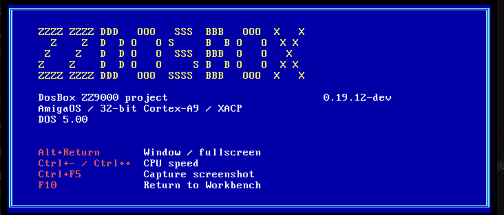
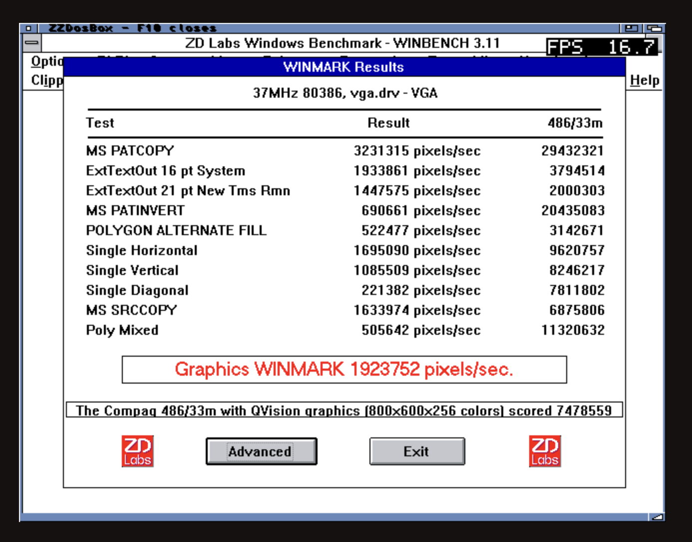

# ZZDosBox-ARM-68K

**DOSBox for AmigaOS and the ZZ9000 Cortex-A9**, based on
[dosbox-libretro](https://github.com/libretro/dosbox-libretro).
The ARM runs the emulated PC; the 68K handles the MUI interface, AmigaOS services
and display coordination through [Xani's XACP platform](https://github.com/Xanxi-Amiga/XACP-ZZ9000).

[Development builds](#development-builds) · [Changelog](CHANGELOG.md) · [Features](#features) ·
[Technical specifications](#technical-specifications) · [Research](#research-and-academic-references) ·
[Dependencies](#dependencies) · [Networking](#networking) · [Build instructions](#build-instructions) ·
[Performance](#optimisation-history) · [Credits](#credits-and-licences)

## Development builds

This is development software. Builds and research artifacts are kept separately:

- [Launcher 0.19.7-dev](artifacts/development/launcher-0.19.7): sidebar navigation,
  startup/loading screens, disk browsing and DOS hard-disk creation.
- [TCP/IP + IPX interpreter runtime](artifacts/development/network-0.18.0):
  optional guest networking through the existing Amiga connection.
- [Console synchronization candidate](artifacts/experiments/console-sync):
  tested in Amiga RAM; not a replacement for the measured default runtime.
- [Current measured Direct runtime](artifacts/development/pic-vfp): ARMv7 JIT,
  4 MiB code cache, NEON pixels and VFP event scheduling.
- [Windows/mouse development build](artifacts/development/mouse): Windows for
  Workgroups 3.11, DOS mouse and PS/2 input validation.
- [Recovery artifacts](artifacts/0.10.1-dev) and
  [build/restore instructions](docs/build-and-restore.md).
- [TinyGL diagnostic builds and measurements](amiga/records/2026-10-14/tinygl-compiler):
  experiments, not replacements for the normal runtime.

## Features

Features below span the current **0.19.7-dev launcher** and its separate DOS,
Windows, network and developer runtimes. Experimental features are labelled;
not every combination is supported.

| Area | Features |
|---|---|
| Native launcher | MUI 3.8+ sidebar navigation, persistent settings, About/credits, ZZDosBox branding, startup and loading screens with shortcut reminders. |
| Program library | Up to 256 profiles; All, Games, Applications and OS lists; add programs, category tags and per-program settings. |
| DOS environments | Embedded DOSBox DOS 5 without installation disks; optional booted MS-DOS 6.22 from the user's installation. |
| Execution | 386-class, 32-bit x86 emulation; ARMv7 dynamic recompiler with 4 MiB code cache for DOS; separate interpreter and paging-guarded Windows builds. |
| CPU and memory | 1/2/4/8 MiB guest RAM; 1000/3000/6000 cycle presets; exact 500–10000 cycle overrides and live adjustment; timed tests or normal sessions. |
| Windows/protected mode | Windows for Workgroups 3.11 tested; 386 paging, nested page-fault recovery, sparse mappings, A20 handling and BIOS/VGA ROM write protection. |
| DOS terminal | Open terminal, run a command or batch file, text/background colours and a versioned welcome screen. |
| Startup files | AUTOEXEC.BAT and CONFIG.SYS editors; Default/Edited/File selection, import/export and recovery of temporary booted-DOS edits. |
| Compatibility helper | Per-profile LOADFIX for programs needing a different conventional-memory load address. |
| Display modes | Fullscreen or resizable Workbench window; 320×240, 640×480 and 960×720 presets; centred 4:3 output and black margins. |
| PC graphics | CGA, EGA, VGA, S3/VESA, Tandy, PCjr and Hercules; S3 exposes 1 MiB VRAM and modes bounded to 1024×768, scaled to the selected output. |
| Rendering | Direct ARM-to-ZZ9000 bitmap output; optional experimental TinyGL software OpenGL. |
| Presentation | Normal or Adaptive frame presentation; optional ARM-drawn FPS counter. |
| Scanlines and colour | Off/Classic/Soft/Gradient software scanlines in fullscreen with FPS off; Hercules White/Amber/Green/Paperwhite palettes; contextual settings help. |
| Keyboard and mouse | DOS INT33/BIOS PS/2 mouse, three buttons, scaled coordinates and button release on focus loss; Alt+Return display switching, Ctrl+minus/plus cycles, F10 exit. |
| Shared files | Writable Amiga drawer as C:, nested directories, DOS 8.3 names and persistent game/application files. |
| Disk images | BIOS floppy/hard-disk boot; select, mount, open and eject raw FAT images in Workbench. |
| Create hard disk | 32/64/128/256 MiB raw FAT16 `.IMG`; startup files and OS library entry; DOSBox DOS 5 by default, optional MS-DOS 6.22 from installed files. |
| Image-backed DOS 5 | Automatically mount the selected image as C: and eject after the session. |
| CD-ROM | Read-only ISO9660 or mounted Amiga data CD; original ZZDOSCD.SYS gateway for booted DOS with the user's MSCDEX. |
| External MIDI | MT-32 intelligent MPU-401 or General MIDI UART through CAMD; output selection and SysEx transport. |
| Driver discovery | CAMD, AHI and ZZ9000AX detection; this does not provide PCM playback. |
| TCP/IP networking — experimental | NE2000/libslirp IPv4 NAT over Roadshow; DHCP/manual addressing, subnet, gateway, DNS, MTU, hostname, ping, DNS lookup, lease controls, counters, logs and cooperative disconnect. |
| IPX networking — experimental | DOSBox-compatible IPX-over-UDP client; relay address/port, connect/status/ping/disconnect. Transport verified on hardware; multiplayer game compatibility remains untested. |
| Compatibility browser | Offline searchable DOSBox community reports, version/result tables and game details/comments in a reading pane. These are upstream reports, not ZZDosBox certification. |
| Configuration | Developer → dosbox.conf editor with validated supported overrides, import/export and defaults; unsupported keys/combinations are reported. |
| Developer tools — experimental | Trace logs, cooperative frame checkpoints, profiling and handoff/poll controls; guest-RAM hex/ASCII monitor, 8/16/32-bit edits with undo, value scanner/refinement and 16/32-bit x86 disassembly. Separate diagnostic runtimes required. |

**Current limits:** PCM sound-card/AHI/HDMI playback, joystick input, emulator
save states, x87 and 64-bit x86 guests are not implemented. Embedded DOS does
not load CONFIG.SYS drivers. Windows networking, guest OpenGL/Direct3D drivers,
GLSL and FPGA 3D acceleration are not provided. Physical drag-resizing and
higher-resolution Windows display drivers still need testing.

[Full feature and compatibility notes](docs/features.md) ·
[Configuration reference](docs/amiga-dosbox-conf.md) ·
[Developer memory tools](docs/amiga-dosbox-memory-tools.md)



## Technical specifications

| Component | Implementation and scope |
|---|---|
| Platform | AmigaOS 3.x / Zorro III ZZ9000; physical development on A4000TX, TF4060/68060, AmigaOS 3.2.3, XX19c / XACP 1.7. Other configurations require validation. |
| Processor split | One application-owned 32-bit Cortex-A9 Core1 worker, nominal 666 MHz; 68K provides AmigaOS files, input, MUI, CAMD, sockets and display coordination. |
| Memory | 32 MiB contiguous owned ZZ9000 block for worker/guest/buffers; 1–8 MiB emulated PC RAM; 4 MiB translated-code cache in the DOS JIT build. |
| Execution protocol | Xani's XACP/PicoDrive-style application model, runtime address mapping, cache/MMU ownership checks and processor-state restoration. |
| JIT | x86-to-ARMv7 translation, cached blocks and instruction-cache synchronization; interpreter fallback where required, including paging in the guarded Windows build. |
| Direct display | ARM writes owned ZZ9000 bitmaps; fullscreen uses acknowledged buffer handoffs, Workbench uses a clipped P96 blit. Frame pixels need not be read back to the 68K. |
| SIMD / NEON | RGB565 conversion, 32-bit copies, 1×/2× scaling, byte swaps, black-row clearing and dimming; exact-output scalar fallbacks. These accelerate host routines, not arbitrary emulated x86 instructions. |
| VFP | Hardware floating-point PIC event scheduling; SIMD/VFP permission checks and preservation of D registers/FPSCR across worker execution. |
| Matrix math | Specialised ARMv7 NEON 4×4 products and batched vertex transforms; ARM CMSIS-DSP and hlsl++ comparisons. These are native research kernels, not production DOSBox dependencies. |
| Software OpenGL | Pinned jserv TinyGL, partial fixed-function API compiled into an optional ARM payload; research covers transforms, clipping, colour/depth spans and per-triangle dispatch. |
| Storage optimization | Read-ahead, redundant-seek avoidance and bounded write-through sector caching; measured Windows builds use a 1 MiB cache. Writes stay synchronous. |
| Host servicing | Timer-based polling, bounded MIDI batches, single-producer/single-consumer queues and occupied-span console synchronization. Latest console cleanup remains a candidate with no measured speed gain. |
| Implementation | C/C++, ARM/68K assembly and Python; pinned upstream sources, compiler metadata, native sanitizers, ARM instruction-model tests and physical target checks. |

### Techniques demonstrated in development

| Technique / theory | What the experiments established |
|---|---|
| Work partitioning and data locality | Keep CPU emulation and pixel work on A9; use XACP handoffs for control. Direct display avoids a framebuffer round trip through Zorro. |
| Specialization and lookup tables | Fast 1×/2× copies, division-free generic horizontal scaling and RGB565 tables improved relevant workloads. |
| Dynamic translation and code reuse | ARMv7 JIT raised measured Doom Demo3 from 3.10 to 6.94 FPS; larger code cache and overlap alone showed no clear additional gain. |
| SIMD versus scalar arithmetic | NEON pixel routines gave about +4.6% Doom throughput; VFP event scheduling about +4.7%, each against its own baseline. |
| Fewer final pixel writes | Adaptive presentation and black scanline preservation can improve speed with a visual trade-off; guest execution remains unchanged. |
| Register reuse and batched matrix work | Specialised NEON reached 2.71× scalar-VFP 4×4-product throughput and 1.59× for 1024 vertex transforms. Whole-scene gains were only 0.2–0.5% in the initial offscreen test. |
| General versus specialised math libraries | CMSIS-DSP improved the 1024-vertex batch by 28.38% but lost on the small 4×4 product; hlsl++ gave only 0.19% whole-scene geometry gain over scalar TinyGL. Neither became a production dependency. |
| Early rejection before SIMD packing | TinyGL scalar rejection plus NEON packing/triangle dispatch gained 28.59% visible fill, 49.00% hidden fill and 5.20% mixed textured throughput in native offscreen scenes. |
| Compiler choices and bottleneck analysis | O3/automatic vectorization, palette unrolling and row dispatch did not consistently improve the relevant application tests. Optimize measured stages rather than assume vector code wins. |
| Cache locality and fewer host requests | A 1 MiB Windows disk cache reduced the measured startup workload's elapsed time by 14.29%. This is not a universal disk or Windows speedup. |
| Correctness before throughput | Exact pixels/bytes, counter-wrap and ownership tests, bounded cancellation, ABBA comparisons and restoration checks accompany optimizations. Console cache-maintenance reduction has no demonstrated FPS gain. |

Figures use different workloads and baselines and must not be added together.
Native matrix/TinyGL results are not DOS-game speedups. See the linked
[optimisation history](#optimisation-history) and reports for conditions.

## Networking

TCP/IP and IPX share the Amiga's existing Roadshow route; they do not take over
its Ethernet hardware or change its address. TCP/IP uses NE2000/libslirp NAT;
IPX uses a compatible UDP relay. Both currently require the separate interpreter
runtime and embedded DOS with Direct/Normal presentation. DHCP/manual IPv4,
DNS, ping, IPX transport and clean disconnect passed bounded physical tests.
Release clears saved guest lease configuration; it does not release the Amiga's
IP address or send an on-wire DHCP release.

PCAP/raw Ethernet bridging is not implemented. Configure networking in the
MUI sidebar; DOSBox-X network configuration blocks are not accepted.

[Networking setup: DHCP, manual IPv4 and IPX](docs/amiga-dosbox-network-setup.md) ·
[Detailed settings and test scope](docs/amiga-dosbox-network-ui.md)

## Dependencies

### Amiga runtime

| Dependency | Version / configuration | Provides | Required? |
|---|---|---|---|
| Zorro III Amiga + ZZ9000 | 68020 instruction target; physically validated with a 68060 | 68K host and Cortex-A9 worker | Yes |
| AmigaOS | Tested on 3.2.3; `workbench.library` v44+, `asl.library` v38+, `graphics.library` v39+ | Workbench, requesters, graphics, Exec/DOS/Intuition/Expansion and timer.device | Yes |
| ZZ9000 firmware / XACP | Tested XX19c / XACP 1.7 | ARM execution and display handoff | Yes |
| ZZ9000 Fast RAM | Card's 256 MB Zorro III RAM enabled; 32 MB contiguous free worker block, plus OS/display memory | Worker code, guest RAM and buffers | Yes |
| Picasso96 and ZZ9000 RTG driver | `Picasso96API.library` v2+; supported 32-bit Workbench and 640×480 fullscreen mode | Window and fullscreen display | Yes |
| MUI | 3.8+; standard classes only | Native launcher | Launcher only |
| Writable application storage | Space for profiles, programs and disk images; 64 KiB application stack | Settings and persistent files | Yes |

Guest PC RAM is selectable as **1, 2, 4 or 8 MB**, inside the worker's 32 MB
allocation. Other 68K configurations and firmware versions remain unverified.

### Optional runtime components

| Dependency | Version / configuration | Provides | Required when |
|---|---|---|---|
| Roadshow | Running TCP/IP stack with `bsdsocket.library` and a working route | Host sockets for IPv4 NAT or IPX UDP | Guest networking only |
| NE2000 packet driver + mTCP | Pinned guest utilities, staged separately | DOS packet driver, DHCP, ping and DNS tools | TCP/IP networking only |
| CAMD | `camd.library` v37+, working output driver and external MIDI instrument | MT-32 / General MIDI output | External MIDI is selected |
| AHI | v4+ supported by the detector | Driver discovery only | Using the audio-driver checker; does not enable PCM playback |
| ZZ9000AX | Installed AHI modes | Optional mode discovery | Using AX detection; not needed to run the emulator |
| diskimage.device + DiskImageCtrl + fat95 | Tested device 37.7; `L:fat95` | Workbench mounting and booted-DOS startup-file editing | Using those disk-image tools; direct BIOS image boot does not need them |
| MS-DOS 6.22 | User-supplied media | Booted Microsoft DOS | Choosing MS-DOS instead of embedded DOS |
| MSCDEX.EXE | User-supplied; paired with included `ZZDOSCD.SYS` | CD access from booted MS-DOS | Using that DOS CD driver |
| Windows for Workgroups 3.11 | User-supplied media | Windows applications | Running Windows |

SDL/SDL2, RetroArch, a development Mac and Amiga-Bridge are not runtime
requirements. The experimental TinyGL renderer is compiled into its ARM payload;
no separate Amiga OpenGL library is required. FluidSynth, Munt and desktop
DOSBox Staging audio/network libraries are not dependencies of this port.

[Detailed Amiga requirements](docs/requirements.md)

### Source and build dependencies

| Dependency | Version / source | Purpose | Required? |
|---|---|---|---|
| Git, Make, Python 3 | Tested with Python 3.14; archive scripts use extraction filters | Source preparation, builds and verification | Yes for building |
| Clang / Clang++ + LLVM + lld | Host tools, including `llvm-nm` and `ld.lld` | Native tests and original x86 diagnostic fixtures | Yes for the supplied workflow |
| Podman or Docker | Configurable container commands | Cross-compiler containers | Yes for the supplied workflow |
| ARM GCC/G++ + binutils | Tested GCC 15.3.1, `arm-none-eabi-*` | Cortex-A9 worker | Yes for ARM builds |
| Amiga m68k GCC + SDK headers | Digest-pinned `amigadev/crosstools` in [toolchain metadata](amiga/upstream.json); AmigaOS, MUI and Picasso96 APIs | 68K launcher and host | Yes for 68K builds |
| Picolibc | 1.8.12; archived PIC libc/source and retained notices | Freestanding ARM C runtime | Yes for ARM builds |
| DOSBox / libretro | Pinned [`a563bb5`](https://github.com/libretro/dosbox-libretro/tree/a563bb5e9753f207d74e9d8c417d793b784fa4be); source bundle included | Emulation engine | Yes |
| ImageMagick | `magick` command | Workbench icon conversion | Launcher/icon builds |
| jserv TinyGL | Pinned [`c2e4859`](https://github.com/jserv/tinygl/tree/c2e48591a6bfba1a85f1b87a78dcf1abf7dff57a); source archive included | Experimental software OpenGL and native scene tests | Optional |
| hlsl++ | Pinned [`3d9af2e`](https://github.com/redorav/hlslpp/tree/3d9af2e77a89ddd645928f1600a0688dc898dedc), with recorded ARM32 compatibility patch | Matrix/TinyGL comparison | Research only |
| ARM CMSIS-DSP | Pinned [`83a2d7b`](https://github.com/ARM-software/CMSIS-DSP/tree/83a2d7bc98c81b4bbe4a6f48b1f2ecf179868a0b) | Standalone matrix comparison | Matrix experiment only |
| libslirp + DOSBox-X NE2000 | libslirp 4.9.5 and pinned Bochs-derived NIC; [source pins](amiga/dosbox/network/upstream.json) | IPv4 NAT and emulated Ethernet | Network build only |
| Unicorn | Python package `unicorn==2.1.4` | Linked ARM instruction-model tests | Model tests only |
| Python MCP SDK + Amiga-Bridge MCP | Working bridge connection and Roadshow or compatible Amiga TCP stack | Scripted hardware transfer and measurements | Remote development only |

The x86 memory-viewer disassembler is adapted from pinned DOSBox source in
[the vendor directory](amiga/dosbox/developer/vendor); no Capstone runtime is needed.
The current host scripts were exercised on macOS and retain some Homebrew paths.

## Developer toolchain

| Area | Implementation |
|---|---|
| Languages | C99/C11, C++17, ARM and 68K assembly, Python |
| Build system | Python preparation/cross-build scripts with Make targets |
| Dependency tracking | Pinned revisions, source archives, compiler metadata and SHA256 manifests |
| Native validation | Exact-output fixtures, bounds tests, AddressSanitizer and UndefinedBehaviorSanitizer |
| ARM validation | Unicorn lifecycle and processor-state restoration tests |
| Hardware validation | Recorded A9 measurements through Amiga-Bridge MCP |

## Get the sources

```sh
git clone https://github.com/SkiltonUSA/ZZDosBox-ARM-68K.git
cd ZZDosBox-ARM-68K
make verify
```

## Build instructions

Start with [Build and restore](docs/build-and-restore.md). The repository preserves
our development toolchain layout; it is not a turnkey SDK installer.

After configuring the ARM and Amiga cross-toolchains and mounting this checkout
at `/work` in the ARM container:

```sh
python3 scripts/restore_build_inputs.py --pic-vfp-build
make test-host
make build-current
python3 scripts/build_dosbox_launcher.py
```

For instruction-model checks, use a Python environment containing Unicorn:

```sh
/path/to/python-with-unicorn tests/amiga/dosbox/check_dynrec_arm.py \
  --out .context/amiga/dosbox-dynrec-4m-neon-pipe-scan-present-adapters-pic-vfp
```

See [TinyGL experiment reproduction](docs/amiga-tinygl-compiler-experiment.md#reproduction)
for the separate rendering tests. Builds and host/model checks do not install
or launch anything on the Amiga.

## Experimental OpenGL / TinyGL

The A9 software renderer uses [jserv's TinyGL](https://github.com/jserv/tinygl),
pinned to [`c2e4859`](https://github.com/jserv/tinygl/commit/c2e48591a6bfba1a85f1b87a78dcf1abf7dff57a).
Thanks to **jserv**, **Fabrice Bellard**, **C-Chads** and the TinyGL contributors.
It provides a partial fixed-function OpenGL API, with specialised depth-test/write
raster paths. Our integration adds bounded memory allocation, pixel presentation
and experimental A9 NEON routines. It is software rendering, not FPGA 3D acceleration.
Direct remains the default renderer.

The latest native TinyGL experiment measured **+28.59% visible fill**,
**+49.00% hidden fill** and **+33.37% mixed colour fill** using
scalar rejection, unguarded NEON packing and per-triangle dispatch. Small triangles
and clipping stay within 1% of scalar speed. Mixed textured scenes gain
**5.20%**; pure texture paths are unchanged. These are offscreen
native-rendering results, not DOS game FPS gains; the changes remain experimental.

[Packing, dispatch and textured results](docs/amiga-tinygl-packing-experiment.md) ·
[Hidden-pixel rejection](docs/amiga-tinygl-rejection-experiment.md)

[Raster results](docs/amiga-tinygl-raster-experiment.md) ·
[Compiler comparison and C-Chads review](docs/amiga-tinygl-compiler-experiment.md) ·
[Matrix/transform research](docs/amiga-tinygl-internal-transforms.md)

## Research and academic references

These informed the experiments; published speedups are not claimed as ZZDosBox
results. Paper PDFs are linked rather than bundled.

| Reference | Connection to this project |
|---|---|
| Kun Feng, Cheng Xu, Wei Wang, Zhibang Yang and Zheng Tian, **An Optimized Matrix Multiplication on ARMv7 Architecture**, *Journal of Convergence Information Technology* 7(10), 2012. [DOI: 10.4156/jcit.vol7.issue10.5](https://doi.org/10.4156/jcit.vol7.issue10.5) | Register reuse, independent accumulators, contiguous data and cache blocking informed the [matrix benchmark](docs/amiga-dosbox-matrix-benchmark.md). No paper implementation was copied. |
| Gaurav Mitra, Beau Johnston, Alistair P. Rendell, Eric McCreath and Jun Zhou, **Use of SIMD Vector Operations to Accelerate Application Code Performance on Low-Powered ARM and Intel Platforms**, IPDPSW 2013, pp. 1107–1116. [DOI](https://doi.org/10.1109/IPDPSW.2013.207) · [Author PDF](https://users.cecs.anu.edu.au/~Eric.McCreath/papers/Use_of_SIMD_Vector_Operations_To_Accelerate_Application_Code_Performance_on_Low_Power_ARM_and_Intel_Platforms.pdf) | Intrinsics versus compiler vectorization and data-movement costs informed [pixel and stage profiling](docs/amiga-tinygl-rasterisation.md#simd-reference). The paper's older compiler results do not predict our GCC 15 build. |
| Arm, **Cortex-A9 NEON Media Processing Engine Technical Reference Manual**, DDI0409I; [Arm documentation](https://support.arm.com/documentation/ddi0409/i/) | Architectural reference for ARMv7 SIMD/VFP work and context handling. A9 NEON vector floating-point arithmetic is single precision; it does not supply x87 emulation. |
| [Xani's XACP framework](https://github.com/Xanxi-Amiga/XACP-ZZ9000) and [ZZPicoDrive](https://github.com/Xanxi-Amiga/XACP-ZZ9000/tree/main/applications/emulators/ZZPicodrive/ZZPicodriveMD) | Basis for the 68K/ARM split, application-owned Core1 and framebuffer execution model. |
| [ARM CMSIS-DSP](https://github.com/ARM-software/CMSIS-DSP/tree/83a2d7bc98c81b4bbe4a6f48b1f2ecf179868a0b), [hlsl++](https://github.com/redorav/hlslpp/tree/3d9af2e77a89ddd645928f1600a0688dc898dedc) | Pinned math-library comparisons: [CMSIS/specialised NEON](docs/amiga-dosbox-matrix-benchmark.md), [hlsl++ results](docs/amiga-hlslpp-benchmark.md). |
| [jserv TinyGL](https://github.com/jserv/tinygl/tree/c2e48591a6bfba1a85f1b87a78dcf1abf7dff57a) | Actual software-renderer dependency; [internal transforms](docs/amiga-tinygl-internal-transforms.md), [rasterization](docs/amiga-tinygl-raster-experiment.md) and [packing/dispatch](docs/amiga-tinygl-packing-experiment.md) experiments. |
| [ermig1979/Simd](https://github.com/ermig1979/Simd/tree/69a630c5569e13a3fed3533f80e323186c904a64) | Reference review for NEON layout/dispatch ideas, not an imported runtime library. [Review](docs/amiga-dosbox-simd-review.md). |

## Optimisation history

Oldest to newest. Percentages compare each change with its own measured
baseline; they are **not cumulative**. Keen/Vette figures are startup
throughput, while Doom figures are real Demo3 game FPS. Most earlier comparisons
are single runs; the latest VFP result uses two runs per build.

- **Direct — ARM-to-ZZ9000 framebuffer output:** pixels are written directly into the display card's framebuffer. **Standalone percentage gain not isolated**; this is the rendering foundation for the comparisons below. [Architecture](amiga/dosbox/pc/direct.cpp)
- **Host scheduling — 1 ms timer polling:** replace tick-based waits with a 1 ms timer — **+116.2% Keen / +66.7% Vette** startup throughput. [Results](amiga/records/2026-10-12/dosbox-scheduling/comparison.json)
- **Scalar pixel scaling — specialised 1×/2× row copies:** **+14.4% Keen / +10.0% Vette**. [Results](amiga/records/2026-10-12/dosbox-scaler/README.md)
- **Framebuffer pipelining — copy/PAN overlap prototype:** **+0.1–0.4% observed; no established gain** in the startup tests. [Results](amiga/records/2026-10-12/dosbox-pipeline/README.md)
- **Compiler optimisation — x86 interpreter `-O2`:** **+7.7% Keen / +4.2% Vette**. [Results](amiga/records/2026-10-12/dosbox-cpu-o2/README.md)
- **Lookup tables — RGB565 colour conversion:** **+16.3% Keen / +14.3% Vette**; exact colours preserved. [Results](amiga/records/2026-10-12/dosbox-profile/README.md)
- **Compiler optimisation — PIC/VGA handlers `-O2`:** **+2.3% Keen / +6.2% Vette**. [Results](amiga/records/2026-10-12/dosbox-events/README.md)
- **Division-free generic scaling and BIOS disk read-ahead:** **hardware gain not isolated**; retained as research, not a measured speed claim. [Evidence](amiga/records/2026-10-13/dosbox-optimisation/artifacts.json)
- **JIT / dynrec — x86-to-ARMv7 dynamic recompilation:** **+124% Doom**, 3.10 → 6.94 FPS, replacing repeated x86 interpretation with cached ARM code. [Results](amiga/records/2026-10-13/dosbox-dynrec/method.md)
- **Framebuffer pipelining — bounded overlap with dynrec:** **+0.24% observed; no established gain**, 6.944 → 6.961 FPS. [Results](amiga/records/2026-10-13/dosbox-tuning/results.json)
- **JIT code caching — increase from 1 to 4 MiB:** **+0.10% observed; no established gain**, 6.961 → 6.967 FPS. [Results](amiga/records/2026-10-13/dosbox-tuning/results.json)
- **SIMD / NEON — vectorised pixel processing:** **+4.6% Doom**, 6.97 → 7.29 FPS versus the same 4 MiB/overlap build. [Results](amiga/records/2026-10-13/dosbox-tuning/method.md)
- **Scanline masking — skip black-row framebuffer writes:** **+3.7% Doom**, 7.33 → 7.60 FPS; optional visual trade-off, not a general rendering gain. [Results](amiga/records/2026-10-13/dosbox-scanlines/method.md)
- **Adaptive — reduce frame presentation frequency:** **+13.5% Doom**, 7.27 → 8.25 FPS; optional, achieved by presenting fewer frames. Normal remains the default. [Results](amiga/records/2026-10-13/dosbox-presentation/results.json)
- **OpenGL — experimental TinyGL software rendering on the A9:** **−32.5% Doom versus Direct**, 7.00 → 4.72 FPS in one matched pair with profiling enabled. This adds a software rendering stage; it is not FPGA 3D acceleration. Direct remains the default. [Results](amiga/records/2026-10-13/dosbox-opengl/method.md)
- **VFP — hardware floating-point PIC event scheduling:** **+4.7% Doom**, 7.29 → 7.64 FPS averaged across two runs per build, with no skipped frames. [Report](docs/performance-pic-vfp.md)
- **TinyGL SIMD / NEON — exact integer colour spans and zero clearing:** **+22.93% visible fill / +7.75% zero clear**, but **−18.66% mostly hidden fill**. Native offscreen scenes, not DOS game FPS; experimental. [Report](docs/amiga-tinygl-raster-experiment.md)
- **Compiler selection — retain O2:** O3 and automatic vectorisation gave **about 14% lower original-fill throughput**. Native TinyGL, three runs per build. [Report](docs/amiga-tinygl-compiler-experiment.md)
- **Scalar rejection + NEON — skip hidden span prefixes:** **+47.30% mostly hidden fill / +12.79% mixed fill / +2.89% visible fill**, with about **3% lower small-triangle throughput**. Dedicated native builds, three runs each; experimental. [Report](docs/amiga-tinygl-rejection-experiment.md)
- **Scalar/NEON triangle dispatch + unguarded packing:** **+28.59% visible fill / +49.00% hidden fill / +33.37% mixed colour fill**; small geometry/clipping within 1% of scalar. Mixed textured scenes **+5.20%**, pure textures unchanged. Native research only, three runs per build. [Report](docs/amiga-tinygl-packing-experiment.md)

These techniques use the existing XACP application/host execution model;
none required a firmware change. Future firmware work should preserve the
Core1, framebuffer-handoff and processor-state restoration contracts.

CPU cycles are a fixed workload budget; see the [CPU settings review](docs/amiga-dosbox-cpu-settings-review.md) for supported controls and the next measurement plan.

Latest follow-ups: [matrix results](docs/amiga-dosbox-matrix-benchmark.md),
[hlsl++ comparison](docs/amiga-hlslpp-benchmark.md),
[NEON row dispatch](docs/amiga-dosbox-pixel-dispatch.md), and
[disk/cache, MIDI batching and console synchronization](docs/amiga-dosbox-optimisation-round2.md).

## Windows measurements

Windows for Workgroups 3.11 booted on the real ZZ9000 A9. WinBench 3.11 completed
Graphics WinMark at **1,923,752 pixels/sec** (640×480, 16 colours, 8 MB guest RAM,
3000 cycles/ms), followed by a clean exit to DOS and Workbench. Its score and
“37 MHz 80386” label use the emulated PC clock and do not establish equivalent
physical PC speed.



[Windows screenshots](docs/screenshots/windows311/README.md) ·
[Windows findings](amiga/records/2026-10-13/dosbox-wfw/findings.md)

## Documentation and contributions

[Changelog](CHANGELOG.md) · [Features](docs/features.md) ·
[Requirements](docs/requirements.md) · [Build and restore](docs/build-and-restore.md) ·
[Research records](amiga/records) ·
[Report an issue](https://github.com/SkiltonUSA/ZZDosBox-ARM-68K/issues)

For bug reports, include the build, firmware, display mode and reproduction
steps. Performance changes should include matching output checks and physical
A9 timings; instruction-model timing is not hardware performance evidence.

## Credits and licences

- [DOSBox team and libretro contributors](https://github.com/libretro/dosbox-libretro): emulation engine.
- [Xani / Xanxi](https://github.com/Xanxi-Amiga/XACP-ZZ9000): XACP platform and application execution model.
- [jserv](https://github.com/jserv/tinygl), Fabrice Bellard, C-Chads and TinyGL contributors: software OpenGL renderer.
- [libslirp contributors](https://gitlab.freedesktop.org/slirp/libslirp), DOSBox-X/Bochs, Crynwr and Michael B. Brutman (mTCP): networking components and guest tools.
- Stefan Stuntz: MUI.
- ARM CMSIS-DSP, hlsl++ contributors, Picolibc and GCC contributors: retained component acknowledgements in [licence notices](licenses/README.md).

Development: **Codex assisted, Amiga-Bridge MCP**.

DOSBox upstream is GPL-2.0-or-later; the combined project includes GPL-3.0-or-later
components. See [LICENSE](LICENSE) and [component notices](licenses/README.md).
Games, Microsoft software and WinBench are supplied separately.
