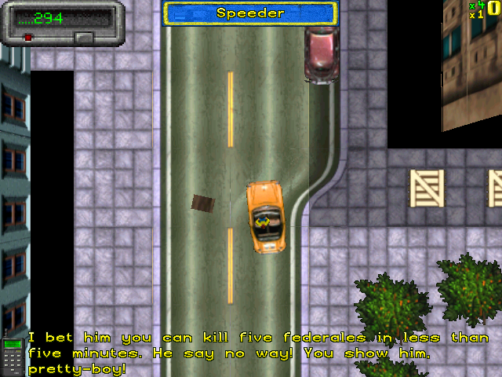

# GTA ECTS live-renderer candidate

The private GTA player renders gameplay on the Cortex-A9 and Amiga through
RasterIX. **The latest profiled comparison improved from 3.96 to 4.50 FPS.** It requires
the experimental streaming firmware; the released DOSBox player remains unchanged.

[Framebuffer reuse: implementation, tests and hardware evidence](frame-cache/README.md)
records the observed +13.6% gain and 41.5% reduction in readback traffic. The first
3.68 FPS measurement is retained below as the original baseline.

The captured gameplay path uses texture decals with ARGB1555 cutouts, square
single-level textures, bilinear filtering and RGB555 linear-framebuffer writes.
It did not request a depth buffer. The candidate implements this observed
subset and stops on unsupported calls. This is not general Glide compatibility.

- 41,997 captured calls replay successfully: 27,300 triangles, 61 swaps,
  552 texture allocations and 2,082,048 texture bytes. All 5,100 translated
  packets pass the firmware validator. This replay does not rasterize or
  establish FPS; the supplied game and capture remain private.
- Full RasterIX simulation passes transparent/opaque cutout checks with nearest
  and bilinear filtering, preserving the background behind transparent texels.
- Core0 owns a bounded request channel. Core1 translates commands, uploads
  textures and requests readback. Each GPU submission must retire before memory
  is reused. Errors retain the GPU lease until recovery.
- Linear-framebuffer writes preserve untouched pixels. Presentation reads back
  RGB565, converts it on ARM and uses the existing Workbench/fullscreen path.
  This initial route includes copy and synchronization costs.
- The frame counter waits for a window paint or fullscreen PAN acknowledgement.
  It records completed swaps and raw timer intervals after ten warm-up swaps.
  The first measured run has a gameplay screenshot, timer calibration and clean
  teardown. Broader rendering and performance validation remains necessary.

## Validation

`test_glide_gta.py` checks mapping boundaries, channel retirement, texture
encoding, framebuffer edits and terminal unsupported calls. Its optional
`--trace` replays a local GTA capture; `--firmware` checks every submitted packet
against the actual validator. AddressSanitizer and UndefinedBehaviorSanitizer
are enabled.

`test_glide_measure_firmware.py` executes the ARM service with modeled I/O:
streaming/benchmark exclusion, upload, readback, delayed completion, clean close,
nonce reuse and failed-lease retention. The existing 25 benchmark scenarios
also pass. `test_glide_gta_pixels.py` verifies the complete RTL renderer's cutout
results using synthetic pixels. These tests do not replace physical execution.

## Next hardware checks

1. Repeat a controlled gameplay interval without capture or file transfers.
2. Profile request submission, framebuffer edits, readback and x86 execution.
3. Compare the same scene against a reference renderer for missing or incorrect pixels.
4. Measure matched gameplay intervals, retaining frame counts, timer calibration,
   CPU cycles, resolution, clock, audio mode and all build identities.
5. Verify Core1 restoration and GPU close after every run. Stop after any
   unverified cleanup; do not retry a possibly active GPU client.

The FPGA is unchanged from the tested carry-free texture-address build. Existing
board timing/CDC limitations still apply. The new Core0 service is experimental.
Empty-session and gameplay startup/exit checks pass on hardware.

## First physical lifecycle and close correction

The initial streaming firmware booted at 800 MHz; global-timer calibration was
399,995,327 Hz. An empty DOS session completed its command and restored Core1
registers/MMU/cache state, but returned RC20 because GPU close failed. The
channel remained active with no requests processed, no work pending and no GPU
error. No GTA gameplay or additional GPU test followed.

The cause was the close precondition: `zc_idle()` required no GPU reservation,
including the very reservation close was meant to release. The correction
separates worker-idle from clock-transition eligibility. Close still checks
Core1, AY, Paula and Copper workers, the matching nonce, outstanding requests
and failed GPU work. Clock changes remain blocked while the GPU is reserved.

The earlier ARM test stub returned idle without considering GPU ownership.
The revised fixture executes the actual generated firmware idle predicates.
It reproduced the physical failure before the fix. Empty-session close, busy
workers, wrong nonce, delayed retirement, failed-lease retention and all 25
existing measurement scenarios now pass in the ARM model.

[Close-fix evidence](close-fix/) records the physical failure, corrected build
and tests. The corrected boot image has been staged, with upload checksum and
writer RC0 verified; boot-card readback has not been performed. The FPGA and
isolated DOS player are unchanged. After a cold restart, the empty DOS session
passed on hardware: RC0, `GLIDE_CLOSE OK`, restored Core1 registers/MMU/cache,
and an inactive channel with no pending work or failure. ARM remained at
800 MHz. The proven paired firmware remains available as `GRXPAIR.bin`.

The first actual GTA session was launched windowed at 640×480, 3,000 DOS cycles,
32 MiB guest RAM and sound disabled. A bridge screenshot request timed out;
network pings and bridge heartbeats continued. After the session was closed,
its recovered log showed 484 completed Glide presentations and clean teardown.
That interval measured 3.70 FPS, but had no visual confirmation. It is retained
as an unconfirmed-scene measurement, not a separate validated gameplay sample.

## First measured gameplay

The fifth physical run reached the GTA ECTS street scene. A player-generated
Ctrl+F5 capture shows the car, road, buildings and HUD. This establishes visible
game rendering; it does not establish complete pixel correctness or compatibility.



| Setting / result | Value |
| --- | --- |
| ARM / GPU clock | 800 MHz / 100 MHz, one TMU |
| Display | 640×480 Workbench window, S3 adapter |
| DOS cycles / guest RAM | 3,000 / 32 MiB |
| JIT cache / Exec allocation | 4 MiB / 64 MiB |
| Audio / PC speaker | Off / off |
| Completed Glide presentations | 491 |
| Warm-up / measured intervals | 10 presentations / 481 intervals |
| Measured elapsed time | 130.811 seconds |
| Completed-frame rate | **3.677 FPS**, rounded **3.68 FPS** |
| Exit | RC0, `GLIDE_CLOSE OK`, owned memory released |

The counter advances only after a completed window paint (or fullscreen PAN
acknowledgement). It is separate from the 25,401 VGA presentation events in the
whole-session log. Timing starts at presentation 10 and ends at presentation 491:

```text
first = 922631194123 ticks
last  = 974954472373 ticks
timer = 399991260 Hz
FPS   = (491 - 10) * timer / (last - first) = 3.677059284
```

Timer calibration before/after was 400,010,729 / 399,991,260 Hz; the reported
calculation uses the latter. ARM stayed at 800 MHz. After exit, temperature was
59.7°C, Core1 idle, GPU channel inactive with no failure or work pending, and
register/MMU/cache restoration checks passed. The bridge reservation was released.

This is one visually confirmed baseline. Screenshot capture and bridge transfers
occurred during the run and can affect its timing. Sound was disabled. Three
intermediate runs stopped at menus/loading with zero Glide presentations; their
VGA refresh counts are not game FPS. They provide no valid cycle-setting comparison.
Held Return input finally advanced the menu, avoiding short injected taps that
were unreliable in this test.

[Measurement and build identities](gameplay-800mhz/measurement.json) ·
[Raw run log](gameplay-800mhz/run.log) ·
[Released channel](gameplay-800mhz/channel-after.log) ·
[Clock and temperature](gameplay-800mhz/clock-after.log) ·
[Artifact hashes](gameplay-800mhz/sha256.json).

The result proves the guest-to-RasterIX route runs on hardware, but 3.68 FPS is
not yet satisfactory gameplay performance. Request batching and framebuffer
transfer costs are profiling candidates; no gain is claimed for them yet.
