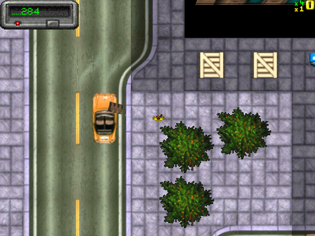

# GTA guest cycle-budget investigation

The retained NEON readback build measured 7.593 FPS at 3,000 guest cycles.
This experiment changes only the session cycle budget to 10,000. The ARM
clock remains 800 MHz; the executable, firmware, guest RAM, window size and
sound-off configuration are unchanged.

The cycle budget controls x86 work per emulated millisecond. A change can alter
guest timer progression relative to host time, not just rendering throughput.
Therefore any result here is a configuration comparison, not another code
optimisation percentage to add to the NEON results. The default profile remains unchanged.

## Initial configuration comparison

The unmodified ReadCopy executable measured **7.593 FPS at 3,000 cycles** and
**8.075 FPS at 10,000 cycles** in separate opening-street samples. Graphics-stage
costs barely changed. The whole-session guest clock differed substantially,
but that counter included loading and menus, so it could not establish gameplay
speed. The higher-FPS configuration was not promoted.

[3,000-cycle log](baseline.log) · [Profile](baseline.json) ·
[10,000-cycle log](cycles10000.log) · [Profile](cycles10000.json) ·
[10,000-cycle capture](cycles10000.png).

## Gameplay interval measurement

The diagnostic build snapshots `PIC_Ticks` at the same completed-presentation
boundaries as the existing FPS measurement: start after ten warm-up frames,
end at the last completed frame. Two previously unused report words carry the
first and last emulated-millisecond values. The existing 64-byte report sync
covers both. The ARM and 68K components are rebuilt together.

No guest timer, cycle budget, interrupt or rendering logic is changed by this
instrumentation. All three measured runs below use the same diagnostic binary;
only the fixed cycle setting changes. The same scripted menu input and sample
waits are used, but loading delays produce different measured durations and
scene progress. These are not deterministic replays.

| Fixed cycles | Frames measured | Wall seconds | Gameplay FPS | Guest seconds | Guest seconds / wall second |
|---|---:|---:|---:|---:|---:|
| 3,000 | 325 | 46.478 | 6.993 | 89.643 | 1.929 |
| 6,000 | 482 | 63.377 | **7.605** | 59.772 | **0.943** |
| 10,000 | 642 | 80.601 | 7.965 | 45.066 | 0.559 |

`guest seconds / wall second = ((last PIC_Ticks - first PIC_Ticks) mod 2^32) /
1000 / measured wall seconds`. FPS uses completed presentation intervals divided
by the same wall duration. Each guest interval is checked against the final
whole-session guest tick count, and the logs confirm the applied cycle setting.

**6,000 cycles is the closest guest-clock match in this sample**, about 5.7%
below real time, while maintaining approximately the retained build's FPS.
The 10,000-cycle run displays more frames per wall second but advances less
guest time. This is a timing trade-off, not another code optimisation gain.
A guest timer ratio does not itself prove correct GTA movement or animation
speed: the game can also use frame-dependent logic. Audio was disabled.

[3,000-cycle log](clock3000.log) · [Profile](clock3000.json) ·
[6,000-cycle log](clock6000.log) · [Profile](clock6000.json) ·
[10,000-cycle log](clock10000.log) · [Profile](clock10000.json) ·
[Diagnostic build/source hashes](clock-build.json).

## Validation and retained state

All four hardware runs returned RC 0 and `GLIDE_CLOSE OK`; register/MMU/cache/
SIMD restoration and owned-memory release passed. GPU status was inactive,
with no working or failed batch. The final temperature was 60.0°C with the
800 MHz KEEP setting retained. Firmware was unchanged.

The interval-logging code is retained in source. The diagnostic executable and
6,000-cycle session remain installed as separate test files. The main retained
ReadCopy player and its 3,000-cycle session are unchanged; its previous 7.59 FPS
result remains the retained baseline. Normal 1.0 Beta is unchanged.

Before selecting a new default, check movement, input response and audio at
6,000 cycles, then evaluate the existing automatic cycle controller. The
remaining guest/event/transport profiling should use this interval clock so
that throughput gains are not confused with changes in emulated time.

[Installed binary/session checksums](installation.log) confirm the main player
and default session are unchanged. [Final GPU-idle check](final-idle.log) passed
before releasing the bridge lease.
