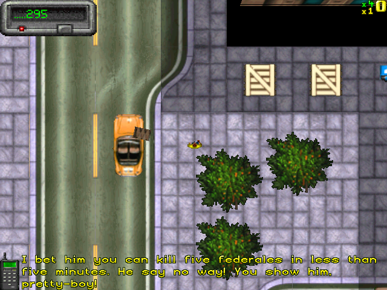

# GTA framebuffer reuse

The experimental player improved from **3.96 to 4.50 FPS (+13.6%)** in one pair
of opening-street gameplay samples. Framebuffer readback traffic per frame fell
**41.5%**. Both runs rendered gameplay and closed cleanly. This is an initial
comparison, not a deterministic replay or a general performance guarantee.

## What the profile showed

The reference build read the whole 640×480 RGB565 framebuffer three times per
frame: for guest framebuffer locks and for presentation. Readback consumed 26%
of measured time. Although there were about 1,105 small uploads per frame, their
combined elapsed time was only 1.6%.

An offline upload-coalescing experiment reduced captured-replay uploads from
2,122 to 128 and passed colour-preservation tests. It was not promoted or tested
on hardware: profiling redirected the work toward redundant readback instead.
The retained implementation keeps the original sparse-upload path.

## Change

- Retain the exact RGB565 framebuffer in the existing comparison buffer.
- Supply RGB555 pixels to the DOS guest when it locks the framebuffer.
- After each successful guest upload, apply those same bytes to the CPU copy.
- Invalidate that copy on GPU draws and clears. Flush queued drawing before
  acquiring a fresh copy.
- Present the current CPU copy directly when it remains valid.

The sixth green bit in RGB565 is preserved for untouched pixels. The guest's
RGB555 conversion cannot reconstruct that bit, so rebuilding the whole image
from guest pixels would introduce colour errors. No extra framebuffer allocation,
firmware change, clock change, dropped scanlines or reduced resolution is involved.

## Hardware comparison

Both builds use 800 MHz ARM, the same one-TMU 100 MHz FPGA, 640×480 windowed,
3,000 DOS cycles, 32 MiB guest RAM, 4 MiB JIT cache, 64 MiB Exec allocation and
sound/PC speaker off. Both include the same timing instrumentation.

| Measurement | Reference | Cached framebuffer |
| --- | ---: | ---: |
| Completed Glide presentations | 161 | 219 |
| Intervals after ten warm-up presentations | 151 | 209 |
| Measured seconds | 38.141 | 46.468 |
| Game FPS | 3.959 | 4.498 |
| Readback bytes/frame | 1,843,200 | 1,078,875 |
| Readback requests/frame | 57.00 | 33.36 |
| Readback time/frame | 65.55 ms | 39.04 ms |
| Timer calibration | 399,993,074 Hz | 399,999,523 Hz |
| Temperature after exit | 59.3°C | 60.3°C |
| Exit / GPU close | RC0 / OK | RC0 / OK |

The candidate averages 1.76 full-frame reads instead of three. It still performs
fresh reads when intervening GPU drawing invalidates the copy; it does not force
a one-read limit at the expense of correctness.

The samples have different lengths and NPC animation is not deterministic.
A screenshot was requested near the end of each measured run; final image
transfers happened after exit. An earlier reference menu capture was transferred
before gameplay. Treat +13.6% as the observed result of this pair. The earlier
unprofiled 3.68 FPS run is historical evidence, not the denominator for this gain.
Audio stability and fullscreen performance were not tested here.

Both runs passed Core1 register/MMU/cache restoration, released owned memory and
left the GPU channel inactive with no pending work or error. The cached-frame
binary replaced the isolated experimental GTA player after checksum verification;
the original binary was retained. The normal 1.0 Beta release is unchanged.

## Verification and evidence

- Native ASan/UBSan tests cover sparse/full/unchanged framebuffer edits, exact
  RGB565 preservation, repeated lock/present reuse and terminal upload failure.
- Draw and clear invalidation are checked against the mock GPU's actual pixels.
  Deliberately omitting either invalidation causes the pixel test to fail.
- The private 41,997-call replay still produces 61 swaps, 5,100 drawing packets
  and 2,122 uploads. Packets pass the actual firmware validator. The replay does
  not rasterize or measure hardware FPS.
- Timing counters separate submit, upload, readback, RGB conversion and display
  completion. They snapshot complete frames after warm-up and publish on exit.

[Comparison](comparison.json) · [Reference profile](baseline.json) ·
[Candidate profile](candidate.json) · [Reference log](baseline.log) ·
[Candidate log](candidate.log) · [Native tests](native-tests.log) ·
[Mutation tests](mutation-tests.log) · [Reference build](baseline-build.json) ·
[Candidate build](candidate-build.json) · [Hashes](sha256.json).

Readback still takes 17.6% of candidate frame time; conversion takes 5.4% and
display completion 10.7%. Roughly 57% is outside these counters and includes guest
execution, framebuffer comparison/conversion and other control work. More detailed
profiling is needed before assigning that remainder to an x86/JIT bottleneck.
