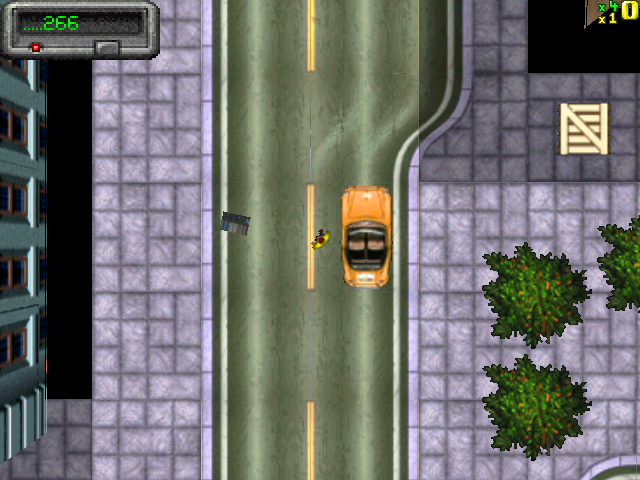

# GTA framebuffer kernels

## Why this path

The retained page-copy player measured 5.768 FPS. Framebuffer lock/unlock work
still cost 31.03 ms per completed frame: 17.9% of measured time. GPU triangle
preparation was only 1.4%, making the framebuffer loops a better target.

## Compiler-only experiment

Changing only `gta.c` from `-Os` to `-O2` measured 5.601 FPS over a longer run.
Lock/unlock self time changed from 31.034 to 30.680 ms/frame, too small to justify
a performance claim. Its final capture was in-car because of an extra Enter
press, so overall FPS is not a strict scene comparison. The compiler override
was removed. It is not part of the retained candidate.

## NEON implementation

- Convert RGB565 to the guest's RGB555 format eight pixels at a time, exactly
  reproducing the existing bit mapping.
- Compare eight guest/shadow pixels at once while locating a row's dirty span.
  The span may include up to seven unchanged pixels at either end.
- Keep the original per-pixel comparisons and changed-run uploads inside that
  span. This preserves untouched RGB565 green bits and leaves upload boundaries
  and ordering unchanged.

The new kernels use the existing frame buffers; they allocate no extra frame.
Other guest-memory, GPU readback and presentation paths remain unchanged.
The GTA module retains its original compiler settings. The separate NEON unit
uses its existing compiler flags and the existing SIMD/FPSCR preservation path.

## Validation

Native ARM tests exhaust all 65,536 colours, short tails, source alignments,
complete-frame buffers and sparse/full dirty patterns. ASan/UBSan and canaries
check bounds. Deliberate colour-bit loss and an incorrect final-pixel bound are
both detected. The complete LFB edit tests run against scalar and actual NEON
paths, including unchanged/sparse/full edits, guest bit 15 and upload failure.
Both variants replay the private 41,997-call capture with the same 5,100 drawing
packets and 2,122 uploads. Native replay does not rasterize or establish FPS.

[Native tests](native-tests.log) · [Mutation tests](mutation-tests.log) ·
[Baseline profile](baseline.json) · [Compiler profile](compiler.json) ·
[Baseline build](baseline-build.json) · [Compiler build](compiler-build.json) ·
[NEON build](neon-build.json).

## Physical GTA result

| Build | Measured intervals | Seconds | Gameplay FPS | Lock ms/frame | Unlock ms/frame |
|---|---:|---:|---:|---:|---:|
| Retained page copies | 409 | 70.912 | 5.768 | 14.202 | 16.832 |
| Compiler-only experiment (rejected) | 692 | 123.545 | 5.601 | 14.059 | 16.621 |
| NEON kernels (retained) | 927 | 147.727 | **6.275** | **9.279** | **10.571** |

The NEON sample completed 937 frames; the counter excludes ten warm-up frames.
Its calibrated timer was 400,098,226 Hz. FPS uses completed RasterIX presentation
intervals, not DOSBox's intermediate display-update count. Lock/unlock values
are exclusive self time, with nested transport costs removed.

Combined framebuffer processing fell **31.034 → 19.850 ms/frame (36.0%)**.
Overall FPS was **8.8% higher** than the previous page-copy sample. This is an
observed opening-street comparison, not a deterministic replay or a general
performance guarantee: the runs have different lengths and player state, and
upload/presentation costs also differ. The NEON capture shows the player on
foot beside the orange car; the rejected compiler sample ends in the car.

All runs used 800 MHz ARM, 3,000 DOS cycles, 640×480 windowed, sound off,
32 MiB guest RAM and the same experimental firmware. Audio and fullscreen
performance were not measured. The compiler-only override is not retained.

[Candidate raw log](candidate.log) · [Candidate profile](candidate.json) ·
[Timer and temperature](candidate-clock.log) · [GPU idle check](candidate-idle.log).

The candidate returned RC 0 and `GLIDE_CLOSE OK`; register/MMU/cache/SIMD
restoration and memory release passed. GPU status was inactive with no failed
or working batch. After the run the board reported 59.6°C and 800 MHz KEEP.

## Retained build

Installed in the isolated `ZZDosBox-Glide-GTA` test player; the previous PageCopy
binary remains available for rollback. The normal 1.0 Beta release and firmware
were not changed. The bridge lease was released after the final idle check.

- Player SHA-256: `87bd125f0ea1a1624b4cfcd6661159fd0db2f97ef373d6ae3a9234ac428b0f22`
- Installed MD5: `98c2d0a4dbd96f71f8a4cef494457917`
- [Installation verification](installation.log) · [Final idle check](final-idle.log)

## Next bottleneck

Readback now accounts for **27.2%** of measured time (43.30 ms/frame).
Framebuffer lock/unlock accounts for 12.5%; triangle preparation is 1.5%.
The 36.9% outside the instrumented stages includes guest execution and other
work; it must not be described as entirely x86/JIT cost. Readback copying and
synchronisation deserve the next investigation, with memory-type and completion
contracts checked before attempting wider loads.
