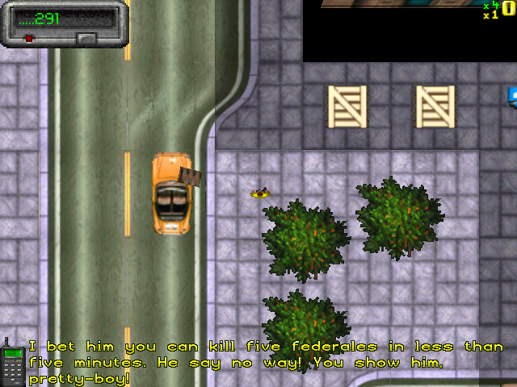

# GTA exact NEON pixel conversion

The experimental GTA player reached **4.73 FPS**, compared with the preceding
cached-frame build at **4.50 FPS (+5.2%)**. Pixel conversion fell from
**12.09 to 3.77 ms/frame (68.8% less time)**. This is one opening-street comparison,
with different sample lengths and nondeterministic NPC activity.

## Implementation

The presenter expands eight RGB565 pixels at a time using ARMv7 NEON, replacing
the scalar RGB565-to-XRGB8888 loop. The integer transforms reproduce the previous
floor-scaled channels exactly: `(x*1053)>>7` for 5-bit red/blue and
`(x*259+3)>>6` for 6-bit green. Output remains 640×480, 32-bit XRGB.
No scanlines, pixels or colour bits are discarded. Unaligned input and tails are
handled. The existing SIMD/FPSCR preservation contract remains in effect.

This operates on the existing cached framebuffer on Core1. Core0 still services
the unchanged RasterIX command channel. There is no firmware or FPGA change.

## Hardware results

Both runs: 800 MHz ARM, one TMU at 100 MHz, 3,000 DOS cycles, 640×480 window,
32 MiB guest RAM, 4 MiB JIT, 64 MiB Exec allocation, sound and speaker off.
Ten completed presentations are excluded as warm-up. Capture happens near the
end; the screenshot is transferred after exit.

| Measurement | Scalar cached frame | NEON cached frame |
| --- | ---: | ---: |
| Measured presentations | 209 | 314 |
| Measured seconds | 46.468 | 66.334 |
| Displayed GTA FPS | 4.498 | 4.734 |
| Conversion ms/frame | 12.087 | 3.766 |
| Conversion share of measured time | 5.44% | 1.78% |
| Readback requests/frame | 33.36 | 34.91 |
| Timer calibration Hz | 399,999,523 | 400,000,341 |
| Temperature after exit | 60.3°C | 60.0°C |

The conversion reduction is the direct stage result. The observed 5.2% overall
increase also includes variation in drawing, readback and display cost. Do not
add it arithmetically to earlier gains or treat it as a guarantee for other scenes.
No audio or fullscreen performance claim is made.

The NEON candidate is installed as the isolated experimental GTA player. The
preceding cached-frame binary is retained, and the normal 1.0 Beta release is
unchanged.

Both runs returned RC0, closed the GPU channel, restored Core1 register/MMU/cache
state and released owned memory. The candidate left no active or failed GPU work.

## Validation

Native ARM NEON tests exhaust all 65,536 input colours, all input alignments
modulo 16, short tails and a complete frame. ASan/UBSan and destination canaries
check bounds. Deliberately dropping the green low bit fails the colour test.
The 41,997-call private Glide replay still validates 5,100 drawing packets and
2,122 uploads. ARM disassembly confirms the NEON loop in the hardware binary.
Native tests do not substitute for the completed Amiga run.

[Comparison](comparison.json) · [Candidate profile](candidate.json) ·
[Reference profile](baseline.json) · [Candidate log](candidate.log) ·
[Reference log](baseline.log) · [Native tests](native-tests.log) ·
[Mutation test](mutation-test.log) · [Build](build.json) ·
[Binary hashes](binary-hashes.json).

Readback still occupies 19.4% of this sample. About 60% is outside the existing
stage counters; separate guest execution, framebuffer-lock conversion and
changed-pixel scanning before choosing the next optimization.
