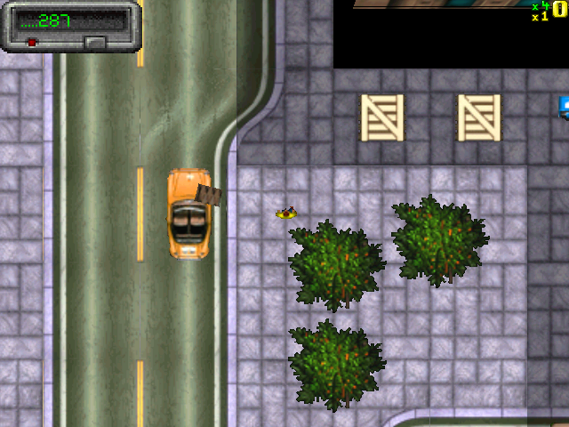

# GTA checked guest-memory page copies

The page-copy candidate measured **5.77 FPS**, compared with **4.72 FPS** for
the instrumented reference (**+22.2%**). Framebuffer lock/unlock self time fell
from **63.68 to 31.03 ms/frame (51.3% less time)**. This is one opening-street
comparison, with different sample lengths and nondeterministic NPC activity.

## Why investigate this path

The reference run reached 4.719 FPS. Exclusive profiling put framebuffer lock
work at 29.55 ms/frame and unlock work at 34.13 ms/frame: 30.1% of total time.
Triangle preparation took only 1.6%. The remaining 28.3% was outside these
counters; it must not all be attributed to the x86 JIT.

## Implementation

The old Glide guest-memory callbacks invoked checked byte accesses for every
byte. The new callbacks use DOSBox's existing readable/writable TLB mapping to
copy the rest of that 4 KiB page, bounded by the requested length. They acquire
another mapping at the next page. Transfer buffers remain outside guest RAM.

A missing direct mapping still uses the original checked byte handler. Mapping
is reconsidered after each handler invocation, allowing lazy TLB initialization
without bypassing device effects, protection faults or JIT code invalidation.
The dynrec code-page handler removes `PFLAG_WRITEABLE`, so these writes remain
handled individually. Overflow rejection and partial effects before a fault
match the old implementation. No physical guest address is invented, no device
registers are mapped as RAM and no DMA engine or cache policy is changed.

## Validation

The native ASan/UBSan test uses controlled page-handler mappings and compares reads/writes against the original checked
byte path over discontiguous mappings, lazy mappings, device/code handlers,
protection faults, empty requests, overflow and invalid pages. It checks copied
bytes, untouched bytes, callback counts and partial effects before failure.
Three deliberate mutations (cross-page copy, bypassed write permissions, hidden
read faults) all fail. Existing Glide packet/LFB tests and private call replay pass.

## Hardware comparison

Both builds use the same extended profiling counters, 800 MHz ARM, one TMU at
100 MHz, 3,000 DOS cycles, 640×480 window, 32 MiB guest RAM, 4 MiB JIT cache,
64 MiB Exec allocation, and sound/PC speaker off. Ten completed presentations
are excluded as warm-up. The screenshots were captured near the end and
transferred after exit. The earlier 4.73 FPS build is not the denominator here;
the current instrumented reference measured 4.719 FPS.

| Measurement | Checked bytes | Checked page spans |
| --- | ---: | ---: |
| Completed presentations | 319 | 419 |
| Measured intervals | 309 | 409 |
| Measured seconds | 65.476 | 70.912 |
| Displayed GTA FPS | 4.719 | 5.768 |
| Framebuffer lock ms/frame | 29.551 | 14.202 |
| Framebuffer unlock ms/frame | 34.132 | 16.832 |
| Triangle preparation ms/frame | 3.274 | 2.418 |
| GPU readback ms/frame | 40.879 | 41.789 |
| Display completion ms/frame | 20.164 | 17.591 |
| Timer calibration Hz | 399,997,618 | 400,000,321 |
| Temperature after exit | 59.8°C | 59.2°C |

The direct stage result is the reduction in framebuffer-processing time. Overall
FPS also reflects scene variation and display cost. No audio or fullscreen
performance claim is made. Firmware, resolution and colour precision are unchanged.
Both runs returned RC0, closed the GPU channel without pending/failed work,
restored Core1 registers/MMU/cache and SIMD state, and released owned memory.

The first candidate attempt remained on the character-selection menu, produced
zero Glide presentations and was excluded; it exited cleanly.

[Comparison](comparison.json) · [Reference profile](baseline.json) ·
[Candidate profile](candidate.json) · [Reference log](baseline.log) ·
[Candidate log](candidate.log) · [Reference build](baseline-build.json) ·
[Candidate build](candidate-build.json) · [Native tests](native-tests.log) ·
[Mutation tests](mutation-tests.log) · [Installation](installation.log) ·
[Evidence hashes](sha256.json).

The page-copy binary is installed as the isolated experimental GTA player.
The preceding NEON binary is retained. The normal 1.0 Beta release is unchanged.

Next targets: the remaining framebuffer conversion/scanning (17.9% of candidate
time) and readback (24.1%). The unassigned 33.1% includes guest execution and
other control work; it is not a direct measurement of x86 execution alone.
