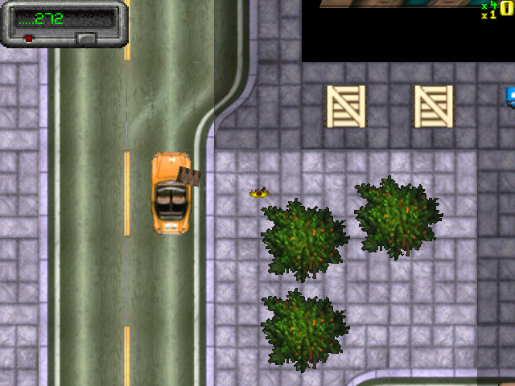

# GTA readback-copy experiment

The previous retained player measured 6.275 FPS, with readback taking 43.30 ms
per completed frame (27.2% of runtime). This experiment replaces only the
Core1 copy from the completed channel payload into the cached framebuffer.

## Memory and completion contract

`channel_plan.h` maps just the firmware-supplied channel pages with small-page
attributes `0x453`: normal non-cacheable memory, execute-never. It is not a GPU
register mapping. Request/result fields retain scalar volatile accesses.
`exchange()` still waits for the matching sequence, checks nonce/error/byte
count and executes its existing barriers before copying the returned data.
The one-outstanding-request protocol prevents Core0 from replacing the payload
until Core1 issues its next request. Firmware cache maintenance is unchanged.

The NEON helper copies 64-byte blocks, then complete 16-byte blocks and scalar
remaining bytes. It does not read beyond the requested span. It uses the
existing saved/restored SIMD context, allocates no buffer and changes no
firmware or memory mappings. Uploads and command submissions retain memcpy.

## Validation

ASan/UBSan tests compare every byte for source/destination offsets 0–15,
lengths 0–129, and 32 KiB minus/at/plus one byte. Destination canaries catch
out-of-range writes; allocations end at the source span. A deliberate wrong
fourth-vector copy is rejected. Existing colour, LFB editing, guest-memory,
stream and scalar/NEON private replay tests also pass.

[Native test log](native-tests.log) · [Deliberate copy fault](mutation-tests.log) ·
[ARMv7 disassembly](copy-disassembly.txt).
Native tests alone do not measure non-cacheable DDR performance or prove GPU execution.

## Physical GTA comparison

| Measurement | Previous NEON framebuffer build | NEON readback copy |
|---|---:|---:|
| Measured presentation intervals | 927 | 774 |
| Measured seconds | 147.727 | 101.930 |
| Gameplay FPS | 6.275 | **7.593** |
| Readback ms/frame | 43.302 | **19.088** |
| Readback bytes/frame | 1,194,998 | 1,188,316 |
| Readback effective MB/s | 27.60 | **62.25** |
| Lock/unlock self ms/frame | 19.850 | 19.892 |
| RGB conversion ms/frame | 3.754 | 3.759 |

Readback elapsed time fell **55.9%**, while bytes per frame differed by only
0.56%. Effective throughput includes the complete request, Core0 service,
completion wait and Core1 copy; it is not a raw DDR bandwidth benchmark.
Lock/unlock and RGB conversion times remained nearly unchanged.

The candidate measured **21.0% higher gameplay FPS**. These are separate
opening-street samples, not deterministic replays: run length, player/camera
position and other traffic differ. Both screenshots show on-foot gameplay,
but the player is further along the pavement in the candidate capture.
The timing change is strongly concentrated in the modified readback path;
the overall FPS percentage remains an observed result for these samples.

Both builds used the same compiler options, experimental firmware, 800 MHz ARM,
3,000 DOS cycles, 640×480 windowed, 32 MiB guest RAM and sound off. Build paths
are the only difference in compiler flag records. This does not establish audio,
fullscreen or general Glide compatibility.

The candidate completed 784 frames; ten warm-up frames are excluded. Its timer
calibration was 399,997,569 Hz. FPS counts completed presentations and is not
the host's intermediate display-update count. Stage times use the existing
exclusive profiling contract.

[Baseline log](baseline.log) · [Baseline profile](baseline.json) ·
[Candidate log](candidate.log) · [Candidate profile](candidate.json) ·
[Timer/clock](candidate-clock.log) · [GPU idle](candidate-idle.log) ·
[Baseline build](baseline-build.json) · [Candidate build](candidate-build.json).

## Retained installation

RC 0, `GLIDE_CLOSE OK`, register/MMU/cache/SIMD restoration and owned-memory
release passed. GPU was inactive with no working or failed batch. Temperature
was 59.3°C, with 800 MHz KEEP still enabled.

The tested player replaced only the isolated `ZZDosBox-Glide-GTA` experimental
binary. The previous LfbNeonSize player remains available for rollback. Normal
1.0 Beta and firmware were unchanged. The bridge lease was released after the
final idle check.

- Player SHA-256: `393e1218a2ef839cc505f523b21dd952f2557274913bd5f970c25087a04e54d0`
- Installed MD5: `d828f2d23df91b37f243d62e187dcd89`
- [Installation](installation.log) · [Final idle check](final-idle.log)

## Remaining cost

Readback is now 14.5% of runtime; lock/unlock 15.1%, display 11.7%, submission
11.6%, and triangle preparation 1.8%. The 40.6% outside the instrumented stages
includes guest execution and other work; it is not a measurement of JIT time
alone. Further experiments should separate guest CPU limits from transport
waiting before changing GPU or firmware behaviour.
