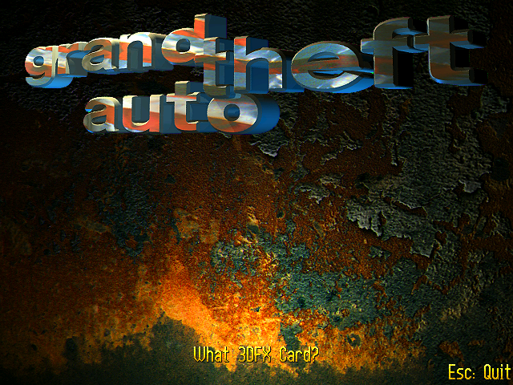

# GTA ECTS diagnostic loader

The supplied GTA ECTS `COMPFX.EXE` loads our **9,308-byte `GLIDE2X.OVL`**
under the native ZZDosBox harness. Selecting Play reaches `grGlideInit`,
`grSstQueryHardware`, then two shutdown calls. The query deliberately returns
false. GTA displays **“What 3DFX card?”** and logs its query failure.



This is a loader and argument-delivery result. No GTA triangle has been
rendered through RasterIX, and there is no GTA ARM or hardware FPS result.
The game error path remained active until the bounded harness stop. Escape
replay did not establish normal DOS exit. The harness closed its file handles.
Its `rc=2, fault=3` records the time limit, not a successful game exit.

## Build and tests

| Check | Result |
| --- | --- |
| DOS/4G LE overlay | 146 decorated exports; GTA loads it |
| x86 machine-code gateways | All 146 tested with bridge present and absent; stack cleanup and nonvolatile registers preserved |
| Floating-point diagnostic return | x87 zero return and stack push checked |
| Guest argument boundary | Invalid IDs, truncated reads, address overflow and DS-relative version writes checked with ASan/UBSan |
| Glide 2 vertices | 60-byte layout; global/TMU0 reciprocal-W selection; failed reads leave output unchanged |
| Viewport clipping | Perspective-weighted interpolation, finite extremes, outside rejection, 15,625 boundary-grid triangles |
| Cortex-A9 clipper | 256 seeded triangles per ABI, soft and softfp; byte-identical to native output |
| Existing encoder | 24 ARM model packets remain byte-identical; 306 batches and ten fixtures pass the unchanged firmware validator |
| Native PC regression | EGA planes, PIT/BIOS IRQ timing and normal DOS return pass with the diagnostic hook enabled |

Export coverage does not mean implemented Glide functionality. This overlay
returns zero from its diagnostic calls, except its DOS loader entry. It never
advertises a rendering board. Argument and vertex callbacks use checked guest
addresses; guest pointers are never cast to host pointers.

The clipper bypasses its four clipping passes for wholly inside or wholly
outside triangles. It preserves preweighted UV and reciprocal-W values.
Exact Glide raster coverage and blended shared edges remain unverified.
The instruction-model results are correctness checks, not cycle measurements.

## Reproduction

Build instructions are in the [component README](../../README.md). Build the
OVL with Open Watcom `2026-11-01-Build`, using the pinned Linux container, then
copy it over `GTADOS/GLIDE2X.OVL` in a **separate test copy** of the GTA ECTS
directory. The original supplied files remain unchanged. The native test uses:

```sh
ZZ_TEST_MACHINE=3 \
ZZ_GAME_DIR=/path/to/private/gta-test-copy \
ZZ_GAME_COMMAND="$(printf 'cd gtados\rcompfx.exe')" \
ZZ_GAME_MS=280000 ZZ_GAME_MEMORY=32 ZZ_GAME_SOUND=off \
ZZ_GAME_INTERACTIVE=1 ZZDOS_FAST=1 \
ZZ_GAME_INPUT=/path/to/private/input-directory ZZ_FS_TRACE=1 \
python3 scripts/build_dosbox_pc.py --compat --x87 --expanded --glide-diagnostic --game compatgame
```

`keys.txt` in that input directory supplies `KBD_KEYS` numeric values and
pressed/released pairs. This run queued Enter (`52`) after 5,500 no-op rows,
then repeated it five times with 998 no-op rows between pulses. Escape (`49`)
was queued later. Rows are consumed by the native interactive poll; they are
not guaranteed wall-clock timestamps. The final trace places the hardware
query at emulated tick 169,498. Screenshots are written to the same private
input directory. Standard VGA failed the game's VESA requirement; S3/VESA
reached the frontend.

The test uses 32 MiB of guest PC RAM and the native build's 1 MiB cache
configuration. It is not the production ARM player's memory/JIT configuration.
Sound was disabled to isolate loading. Recorded frame counts include VGA
refreshes and frontend activity; they must not be reported as gameplay FPS.

## Remaining gates

GPU retirement/readback and intermittent physical probe freezes are still
unresolved. The inspected Core0 ABI also rejects depth/stencil. A real game
path additionally needs texture allocation, formats/palettes, Glide state,
LFB access and verified frame presentation. No release or installed player
was replaced by this diagnostic work.

Files here contain test output and hashes, not game binaries. The ABI table
is credited under [its MIT attribution](../../abi/README.md). No Glidulator
renderer or worker implementation is included.
