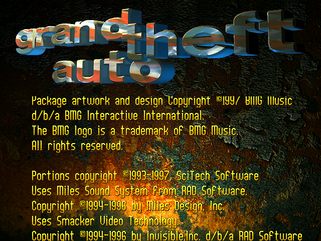
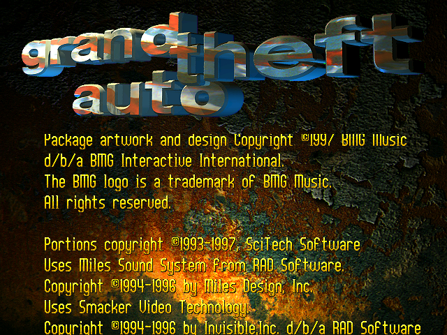

# Timed GTA ECTS comparison

The native test harness now accepts `ZZ_GAME_TIMED_KEYS=/path/to/events.txt`.
Each row is `emulated_millisecond key_number pressed`. Events are delivered
once, in order, when due, including after an irregular polling interval.
The log records both planned and actual delivery ticks. The existing live
`keys.txt` input remains available when this option is absent.

This avoids interpreting input-row counts as elapsed time. Unit tests check
missed polling boundaries, repeated polls, ordered catch-up and invalid input.
It is a native research-harness change, not an Amiga input or performance change.

## Matched comparison

The same schedule, S3/VESA, 32 MiB guest RAM, 3,000 cycles and disabled sound
were used with the diagnostic OVL and GTA ECTS's original OVL. Separate input
and capture directories were used; original game files were not changed.

| Observation | Diagnostic OVL | Original OVL |
| --- | --- | --- |
| Glide overlay opened | 9,308 bytes | 338,207 bytes |
| No-board query failure | Yes | Yes |
| Scheduled input delivered at requested ticks | Yes | Yes |
| Escape advances to credits | Yes | Yes |
| Normal DOS exit established | No | No |
| Bounded harness stop; handles closed | Yes | Yes |

Both runs stopped at the 310,000 ms emulated-time limit (`rc=2, fault=3`).
The screenshots show their credits at that point. The earlier lack of a clean
DOS exit is therefore not unique to the diagnostic gateway. This comparison
does not establish that every shutdown detail matches, or that the game works
with a real GPU. It also does not prove that replay timing caused the earlier
result. A separate EGA/PIT fixture still returns to DOS and exits normally.

| Diagnostic OVL | Original OVL |
| --- | --- |
|  |  |

Use the [loader-test command](../guest-loader/README.md), add
`ZZ_GAME_TIMED_KEYS` pointing at the included `events.txt`, and set
`ZZ_GAME_MS=310000`. Use a private copy for the replacement OVL. The retained
traces and hashes distinguish the two runs; game binaries are not included.
Recorded frame counts are refresh/frontend activity, not gameplay FPS.
