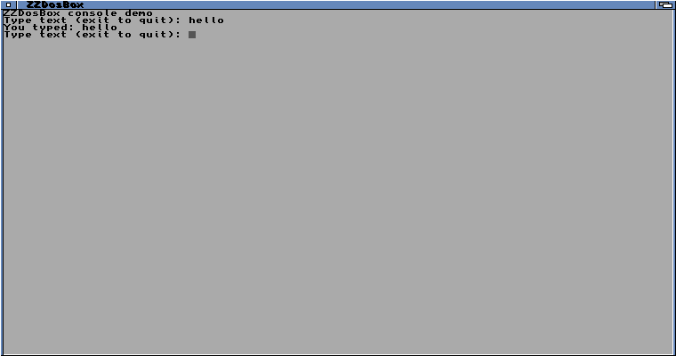

# Streaming console — 12 October 2026

ZZDosBox 0.3.0-dev passed five physical checks: DOS console API/long output,
input-wait cancellation, full-output cancellation, native keyboard/window use,
and closing the window while the DOS program waited for input.

The API transcript matches all 5,032 bytes. The interactive run typed `hello`
and `exit`, matches the independently constructed 118-byte transcript and exits
normally. All five runs restore registers/cache witness and release owned RAM.
The final state is Workbench with the bridge up and no Core1 owner.

`build.json` identifies the installed executable, ARM payload and source inputs.
`result.json` summarizes checks; the five named logs are physical evidence.
`native-asan.log`, `dos-regression.log` and `arm-model.log` are local checks.
The six ARM-model cases cover two relocation bases, full buffers, counter
wraparound and both blocking cancellation paths; they are not cache/FPS proof.
No DOS shell, VGA, PC BIOS input/video, FPU or audio is claimed.

An earlier AmigaDOS handler attempt did not display a window. It was stopped
with Break and released Core1 cleanly. The final host uses an explicit
Intuition window and asynchronous console.device reads. No reboot or firmware
change was required. Installed NES/SNES applications were not changed.
