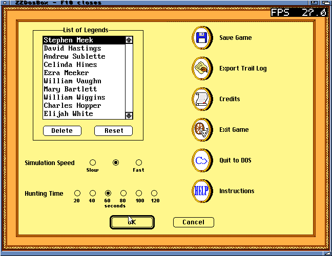
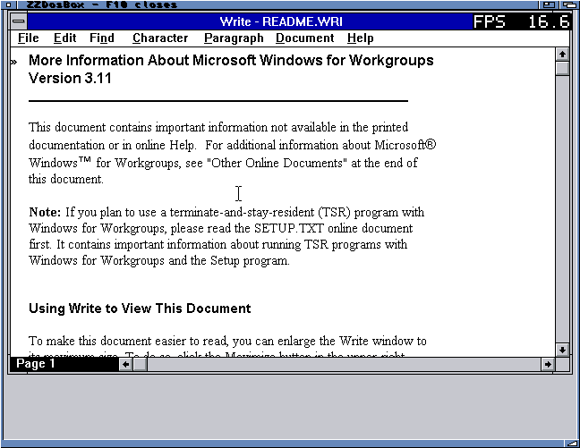

# DOS and Windows mouse support — 13 October 2026

Added the upstream DOSBox mouse driver to the ZZ9000 PC build, plus a bounded
Intuition-to-Core1 event queue. The queue carries normalized position and three
button bits, with separate producer/consumer cache lines and checked bounds.
DOS uses INT33; Windows uses the BIOS PS/2 callback and IRQ12 path. The 68K
forwards input; mouse emulation and guest cursor drawing run on the A9.

The host maps the painted image rather than the Workbench window frame. Focus
loss and display changes release held buttons. The final build hides the host
pointer over the guest image and restores it outside. Callback code stays in
reserved BIOS storage so booted DOS can use conventional RAM safely.

## Verification

- Native ASan: position, three buttons, release, ring wrap and PS/2 callback.
- Linked ARM model: the same input path, malformed events and cancellation;
  full PC regression suite passed. No hardware-speed inference from these tests.
- Physical Oregon Trail Deluxe: VGA 16-colour startup, mouse-operated Options
  page, mouse Quit to DOS, game-file writes and clean Workbench return.
  Recorded 14 host events, five presses and five releases.
- Physical Windows for Workgroups 3.11: installed Microsoft/IBM PS/2 driver,
  moved pointer, double-clicked Read Me to open Write, closed Write, exited
  Windows to DOS, then closed the emulator. Recorded six host events, two
  presses and two releases. HDD/handles closed; cache/register checks passed.

Windows retains a backup of its previous mouse configuration. The supplied
Windows driver, DOS/Windows images and commercial games are not in this repo.
The installed Empire Deluxe and Civilization files are not a full compatibility
claim. Oregon's test is menu-level, not a complete playthrough. Pointer capture/warping for continuous relative-motion games is not implemented;
third-party DOS mouse-driver compatibility is not fully tested. No new game-speed or WinBench performance claim is made.

## Final executable check

The final 977,864-byte executable keeps the exact model-tested ARM payload.
Its additional host change hides/restores the Workbench pointer. A fresh
physical Oregon run exercised four window/fullscreen switches and a fullscreen
mouse selection that entered the trail introduction. It recorded 1,526 input
events with 20 presses and 20 releases, then passed register/cache restoration
and released its allocation. The first injected F10 during the asynchronous
view change did not close the session; repeating it after confirming the
active window completed the normal shutdown.

## Screenshots

## Source references

- [Pinned DOSBox mouse implementation](https://github.com/libretro/dosbox-libretro/blob/a563bb5e9753f207d74e9d8c417d793b784fa4be/src/ints/mouse.cpp)
- [Xani's XACP platform](https://github.com/Xanxi-Amiga/XACP-ZZ9000)
- [DOSBox Windows guidance](https://www.dosbox.com/wiki/Software:Windows3x)

Build hashes and individual test logs are alongside this record.
