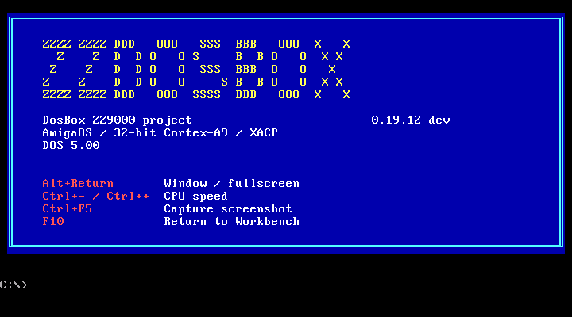

# ZZDosBox launcher 0.19.12-dev candidate

The library layout was captured on hardware. Screenshot capture and footer hover
remain unverified because the target connection stopped responding during testing. This is not a validated runtime replacement. See
[validation](validation.md).

Incremental update for an existing ZZDosBox installation with MUI 3.8+ and
Picasso96. Close the launcher and player before replacing files.

- Copy `ZZDosBox-Launcher` and `ZZHELLO2.COM` into the application drawer.
- Copy the executables from `runtimes/` into the same drawer. These add screenshot
  capture while retaining the previous ARM payloads.
- Keep your existing library, configuration and support files.

Choose a game, application or OS. **Capture...** launches it; **Ctrl+F5** saves
its current display and **F10** returns to the library preview. The loading
screen includes these keys. PPM pictures are kept locally in `Snapshots`.

Includes loading handoff, Rename, confirmed game/application deletion, protected
OS/shared installations, mounted images in OS, keyboard selection, About history,
IMG/VHD guidance and the footer revision. Hover over Delete for its footer help.

See [launcher controls](../../../docs/amiga-dosbox-launcher-navigation.md) and
[disk formats](../../../docs/amiga-dosbox-disk-images.md).

The DOS welcome panel has a yellow ASCII title, red shortcut labels, white
descriptions, current version and Ctrl+F5
instructions. Known older ZZHELLO2.COM helpers upgrade on next launch, retaining
one `.BAK`; unrelated same-name files are left alone.

This preview is from native DOSBox execution on the development host, not a
physical Amiga capture.

To relink a variant without rebuilding ARM code, use
`scripts/relink_dosbox_snapshot_host.py` with its `relink-inputs/<variant>` path.
For the network variant supply `--network-library` pointing to the included
`relink-inputs/network/libzznetwork.a`. Requires the documented cross compiler
container. Generated headers preserve the embedded ARM image and mapping probe.
