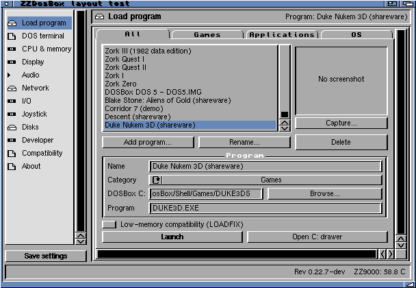
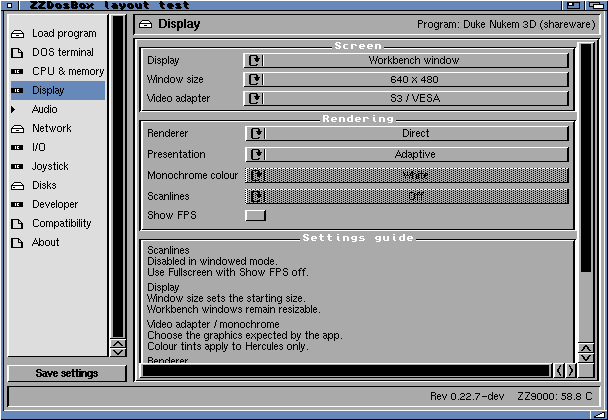

# Scalable launcher validation

The production m68k launcher builds with warnings treated as errors. Native
screen-budget checks and existing profile/session/migration tests pass.

On the physical Amiga, the diagnostic launcher exercised every main section
using 640×480, 800×600 and 1024×768 **window budgets on the existing desktop**.
It did not change the Workbench screen mode. Each run visited all 12 sections,
scrolled each viewport to its limits, resized through 480×360, 608×360 and
768×360, opened the loading card and exited cleanly without saving profiles
or starting a game/ARM worker. All three final reports pass.

The 640×480 budget opened a 608×420 window with a 438×321 content viewport.
The loading card was 315×157. Most pages need no horizontal scrolling at
this size; the joystick diagram can be scrolled horizontally. Display and
Network use vertical scrolling for their additional content.

MUI remembers window sizes. Compact/regular layouts have separate window IDs;
800×600 reused the previous compact size and the larger-layout test reused its
previous size. Both could subsequently be enlarged. An embedded Virtgroup
subclass removes the maximum-size constraint inherited from short pages.

These are real MUI/AmigaOS execution tests, not tests of an actual 640×480
Workbench mode. No global screen, font or MUI preferences were saved. No game
performance or audio claim follows from these launcher-only checks.

Reports: [640](layout640.log), [800](layout800.log), [1024](layout1024.log).
Reproduce native checks with `make test-launcher-layout`; see
`scripts/test_dosbox_launcher_layout.py` for the isolated physical probe.

Installed the production launcher on the Amiga. Its checksum matches the build,
the previous executable is retained, and Launcher.cfg plus dosbox.conf match
their pre-install checksums. The installed launcher reopened successfully.
Both 0.22.7 Beta installer editions include this verified launcher.
