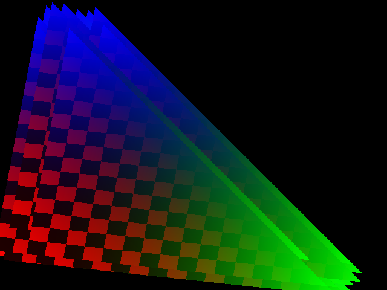

# TinyGL packing and triangle dispatch

Follow-up to [hidden-pixel rejection](amiga-tinygl-rejection-experiment.md).
All candidates use pinned jserv TinyGL `c2e48591a6bfba1a85f1b87a78dcf1abf7dff57a`,
O2, original clears, scalar transformations and private 640x480 colour/depth
buffers. Installed DOSBox is not replaced. These are native renderer experiments,
not DOS game FPS or framebuffer scanout measurements.

## Dedicated candidates

- **Scalar:** original upstream span routines.
- **Guarded hybrid:** scalar rejected-prefix skipping followed by guarded NEON
  colour packing, retained from the previous experiment.
- **Unguarded hybrid:** identical prefix rejection, followed by the original
  NEON packing routine without the compiler barrier. This removes an empty
  assembly scheduling constraint, not a hardware memory barrier; XACP/cache
  synchronisation and processor-state restoration remain unchanged.
- **Triangle dispatch:** unguarded hybrid for larger triangles, with original
  scalar routines for narrow/short triangles. Selection occurs once per triangle.

The dispatcher uses bounding dimensions and twice the triangle area. Dividing
that area by vertical extent gives the maximum horizontal width; a multiplication
comparison avoids doing that division. It chooses scalar for width below 32,
height below 8, or area below 32 times height. Integer edge rounding may change
which path is fastest at the boundary, but both paths preserve identical output.
64-bit intermediates cover the clipped viewport coordinates without overflow.

The original bounding-box-only selector sent only 2 of 256 clipped triangles
to scalar: rotation made thin triangles have a large bounding box. Adding the
area test selects 240 of 256. Host-only coverage confirms:

| Scene | Scalar triangle calls | NEON triangle calls |
|---|---:|---:|
| Small triangles | 1,024 | 0 |
| Clipping | 240 | 16 |
| Visible fill | 0 | 32 |
| Mostly hidden fill | 0 | 32 |
| Textured fill | 0 | 0 |
| Hidden textured fill | 0 | 0 |
| Mixed textured/untextured | 1 | 17 |
| Mixed untextured | 3 | 36 |

Clipping can generate additional triangles. Textured triangles use the untouched
upstream texture rasteriser and are intentionally absent from these counters.
No instrumentation is included in physical timing builds.

## Textured workload

The suite replaces the old three clear-control rows with visible textured fill,
hidden textured fill, and mixed textured/untextured geometry. It uses a generated
256x256 RGB checker/gradient texture, depth testing, the existing model/projection
transforms, and overlapping triangles. It is a synthetic textured 3D stress scene,
not a game. The mixed case exercises both original texture and candidate colour
paths. Per-triangle API setup is now common to every candidate, so timings must
be compared within this new suite rather than directly with the old fixtures.

The first four untextured and final mixed hashes remain unchanged. New colour/
depth hashes: textured visible `4b2ca271`, textured hidden `b51db76e`, mixed
texture `a7843612`. The native reference preview is saved with the evidence;
it is not an Amiga screen capture.



## Validation

Native ASan/UBSan checks pass 206,080 span cases over five kernel modes, all depth
variants, alignments, tails, wraparound and pass/reject/equality patterns. Each
of the four dedicated builds matches the same 32 complete scene/depth hashes.
Existing clear tests remain enabled. The physical payload runs 13,120 bounded
kernel checks before timing. The linked ARM model checks normal completion,
copy cancellation, unavailable SIMD and cancellation during scene execution.

RST3 retains eight 48-byte rows in the existing bounded report. Every column in
a dedicated build repeats its one fixed algorithm. Physical batches use the
same 0,1,2,3,3,2,1,0 order and 16 timed frames per column. Model-only quick mode
uses one warm-up and one timed draw per column; its synthetic timing is never
used as performance evidence. Hashing stays outside timing.

All four ARM builds and all sixteen linked lifecycle checks passed. All twelve
physical runs also passed; no candidate has been promoted to the installed runtime.

## Physical results

Twelve physical A9 runs completed: three per dedicated build. For each scene,
average its four equal timing batches within each run, then take the median of
three runs. All other ARM object hashes are identical; only `ztriangle` differs.
Each physical colour/depth hash also matches its native reference. Times below
are milliseconds per scene; gain means throughput, computed as scalar time /
candidate time minus one, not percentage reduction in elapsed time.

| Scene | Scalar ms | Guarded ms | Unguarded ms | Dispatch ms | Dispatch throughput |
|---|---:|---:|---:|---:|---:|
| Small triangles | 6.933 | 7.030 | 7.101 | 6.908 | +0.36% |
| Clipping | 4.341 | 4.440 | 4.439 | 4.371 | -0.69% |
| Visible colour fill | 77.632 | 75.470 | 60.343 | 60.373 | +28.59% |
| Mostly hidden colour fill | 40.605 | 27.581 | 27.189 | 27.251 | +49.00% |
| Textured fill | 215.331 | 215.155 | 215.145 | 215.128 | +0.09% |
| Hidden textured fill | 59.653 | 59.541 | 59.548 | 59.608 | +0.07% |
| Mixed textured/colour | 136.245 | 130.095 | 129.495 | 129.505 | +5.20% |
| Mixed colour fill | 63.665 | 56.431 | 47.736 | 47.735 | +33.37% |

The unguarded packer retains rejected-prefix savings while allowing freer compiler
scheduling of colour arithmetic. Per-triangle dispatch brings small geometry and
clipping close to scalar speed while preserving the larger-fill gains. Changes
under 1% are treated as near parity, not a useful optimisation claim. Pure texture
paths remain effectively unchanged; mixed textured scenes benefit only where they
also draw untextured triangles. This is not a texture-sampling optimisation.

Prefer the dispatch build for further native TinyGL research. Do not promote it
as a DOS performance improvement: the emulator's current OpenGL presentation uses
`glDrawPixels`, not these triangle routines. Representative native 3D applications
and texture-raster profiling remain necessary before wider integration.

Every physical run passed its kernel checks, image/depth hashes, EGA/PIT/shell
fixture, SIMD/register/MMU/cache-witness restoration and owned-memory release.
The installed runtime checksum remained unchanged. No candidate was installed.

[Raw comparison](../amiga/records/2026-10-14/tinygl-packing/comparison.json) ·
[Exact builds, logs and source snapshots](../amiga/records/2026-10-14/tinygl-packing/README.md)

## Reproduction

Use `scripts/test_dosbox_tinygl_raster.py --fixed-mode MODE`, with MODE one of
`scalar`, `hybrid`, `unguarded`, `dispatch`. The separate
`scripts/test_dosbox_tinygl_triangle_dispatch.py` checks path coverage.

Build with the established raster diagnostic flags and `--pc-raster-fixed MODE`:

```sh
python3 scripts/build_dosbox_dos_arm.py \
  --container-command '["podman","--connection","nuflix-converter-root"]' \
  --pc --pc-dynrec --pc-jit-mib 4 --pc-neon --pc-pipeline \
  --pc-scanlines --pc-presentation --pc-adapters --pc-pic-vfp \
  --pc-matrix-bench --pc-tinygl-bench --pc-tinygl-raster \
  --pc-raster-fixed dispatch
```

Snapshot each build before rebuilding another variant. Run the linked model
checks before physical execution. The RAM-only staging/measurement helper checks
Core1 ownership, binary checksums, closed logs, restoration and memory release.
Analyse three closed physical logs per build with `--fixed-build`, then use
`scripts/analyse_dosbox_tinygl_packing.py` for the dedicated comparison. It checks
identical frame hashes and that only the triangle ARM object differs.
