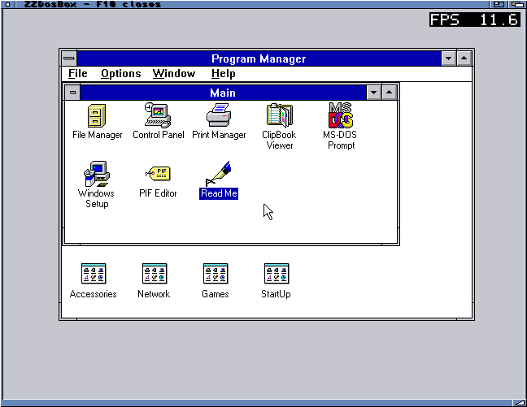

# Network, software-OpenGL and Windows timing candidates

Fresh source builds extend the opt-in timer calibration to the remaining
player configurations. They select the 400 MHz timer at the standing 800 MHz
ARM setting. No firmware, default clock, launcher or release package changed.

| Candidate | Build identity | Physical checks |
| --- | --- | --- |
| Network JIT | [Record](network-build.json) | Doom with networking enabled; DHCP and exact HTTP transfer |
| Software OpenGL | [Record](opengl-build.json) | Doom, windowed and fullscreen Adaptive presentation |
| Windows interpreter | [Record](windows-build.json) | Booted disk image, bounded execution and teardown |
| Windows JIT | [Record](windows-jit-build.json) | Booted disk image, bounded execution and teardown |

The network/OpenGL candidates use 4 MiB JIT, 8 MiB guest RAM and a 32 MiB Exec
allocation. Network retains its 1 MiB disk cache. Windows builds preserve the
recorded non-PCM configuration, 1 MiB disk cache, pipeline off and the original
interpreter/4 MiB JIT choices. Their packaged binary identities were traced to
the original base records; see [Windows provenance](windows-provenance.json).
The JIT still falls back to the interpreter when guest paging is enabled.

## Physical validation

Doom runs used 10,000 cycles and 20,000 guest milliseconds. Network-on, TinyGL
windowed and TinyGL fullscreen completed all 640,000 stereo audio frames.
TinyGL confirmed renderer closure. It is an ARM software presentation path,
not a guest OpenGL driver or a RasterIX/GPU test.

The network guest loaded the NE2000 packet driver, obtained `10.0.2.15` through
DHCP and fetched the exact 4,099-byte fixture from a temporary LAN HTTP server.
The backend closed with 13 TX / 10 RX packets, zero drops and zero errors.
[Transfer identity](http-result.json). This does not validate Windows networking,
external Internet connectivity, IPX multiplayer or sustained transfer performance.

Windows tests used a private copy of the installed 32 MiB disk image, 8 MiB
RAM and 6,000 cycles. The first runs completed 12,000 guest milliseconds;
later runs completed 18,000 and both reached the Windows Program Manager desktop. They stop through the test
harness, not Windows' shutdown menu. The original disk image is not modified.

Every recorded run passed SIMD/FPSCR context checks, register/MMU/cache
restoration, file closure and owned-memory release. Audio gaps remain in the
PCM players. These bounded integration tests do not establish a game-FPS gain
or an audio-quality improvement. [Measurements and raw logs](hardware.json).

## Build and instruction-model corrections

The network builder previously ignored the configured m68k SDK and tried an
obsolete Podman connection. It now uses `AMIGA_CONTAINER_COMMAND`, including an
explicit override forwarded by the main ARM builder. The failing connection
was reproduced before the edit; the full network rebuild passes afterwards.

The ARM instruction model initially rejected calibrated builds with `ARM timer
ABI mismatch`: its simulated host had not supplied the new timer fields. It
now publishes the selected timer ABI and adjusts synthetic presentation work
to the requested rate. No production guard was relaxed. Four paging cases
(aliases, instruction-fetch faults, read/modify/write and nested faults) pass
at both 333,333,333 and 400,000,000 Hz, including the paged-JIT fallback check.
These are synthetic timing tests, not physical stock-clock measurements.

[Paging model log](paging-after.log) · [Network/host sanitizer tests](native-network.log) ·
[TinyGL image-oracle tests](native-opengl.log).

## Remaining release checks

Calibration remains opt-in. Stock-clock hardware, coordinated versioning and
installer/launcher integration remain pending. Windows application benchmarks,
interactive exit and user-input regressions are outside this pass. Historical
performance results keep their original player identities and test settings.

## Desktop captures

| Interpreter | JIT with paging fallback |
| --- | --- |
|  |  |

The overlay reports presentation FPS. These screenshots are compatibility
captures, not a WinBench result or a measured application-speed comparison.
