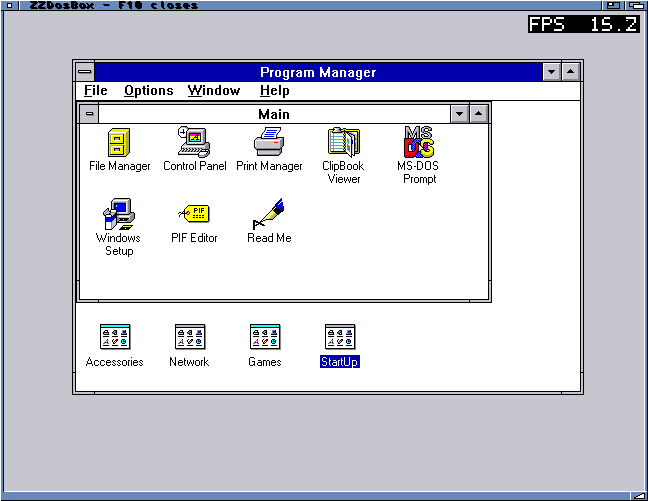
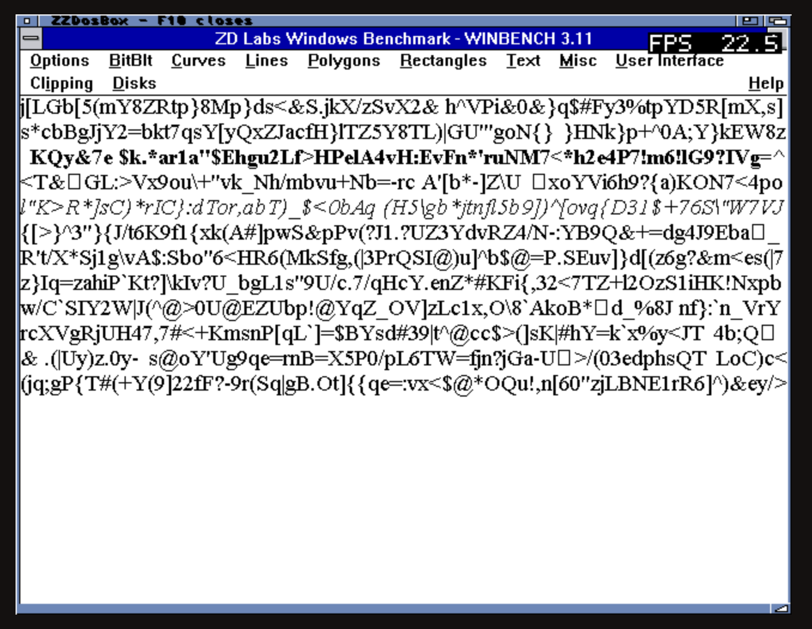
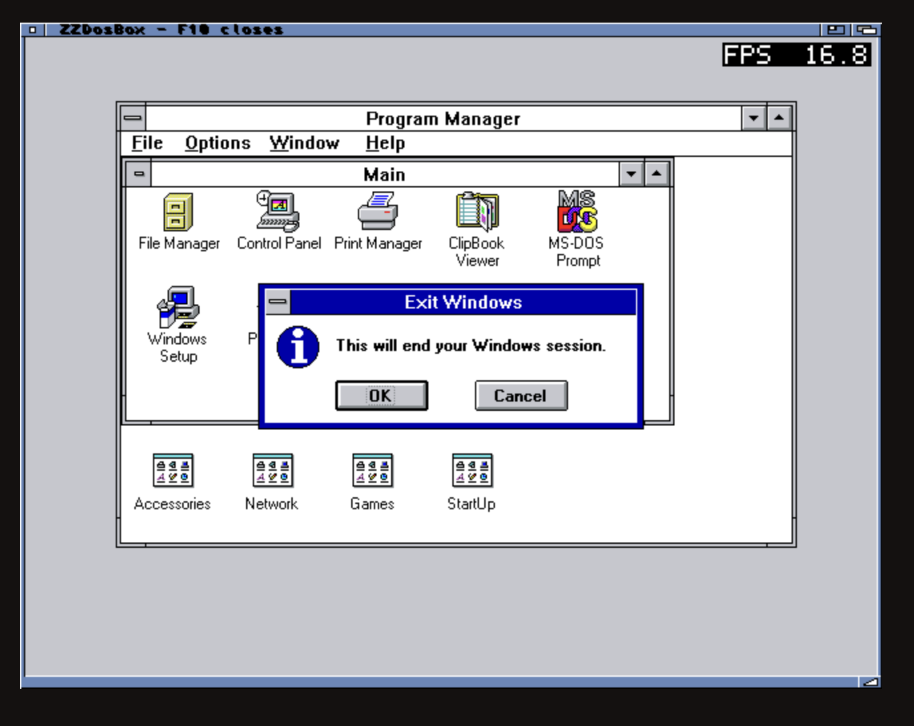

# Windows 3.11 on ZZDosBox

Windows for Workgroups 3.11 running on the physical ZZ9000 Cortex-A9.

WinBench 3.11 text-rendering test:

Graphics WinMark: **1,923,752 pixels/sec** at 640x480/16 colours, 8 MB guest RAM
and 3000 cycles/ms. Scores and the displayed 37 MHz CPU estimate use the
emulated clock; they do not establish equivalent physical PC performance.
The FPS overlay counts display refreshes.

Windows exited to DOS, followed by a clean return to Workbench.

The text-test, result and exit screenshots were supplied by the user.
[Full test record](../../../amiga/records/2026-10-13/dosbox-wfw/findings.md).
